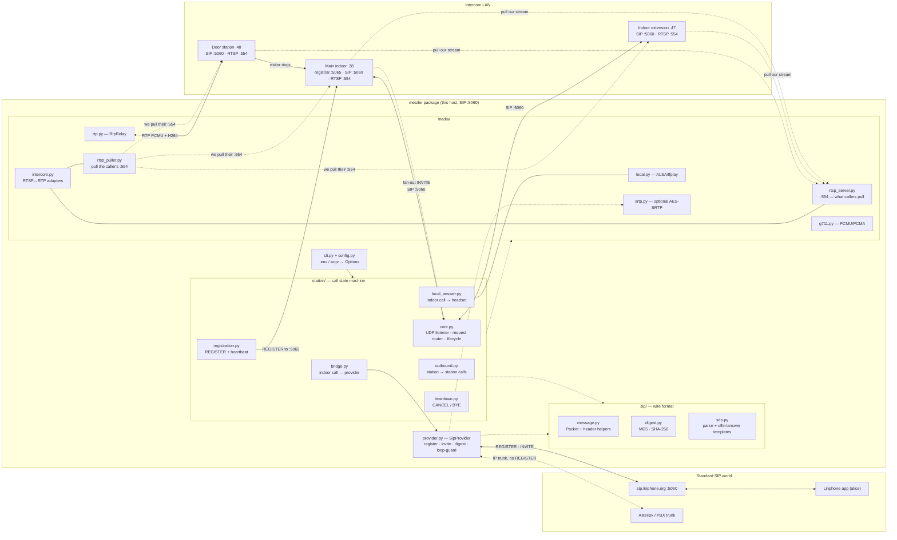

# Simulator architecture

`src/metzler/` — a Python indoor station for the Metzler/Hikvision video
intercom. It registers as an extension on the main indoor station's private
registrar, accepts proprietary intercom/door calls, and bridges them either to
a standard SIP endpoint (hosted provider or PBX) or to a local headset.

Everything runs in one process. The standard library covers all core paths;
`cryptography` is needed only for SRTP on the provider leg.

## Component overview

<!-- mermaid: architecture -->

## Module map

| Path | Responsibility |
|---|---|
| `cli.py` | argument parser, `finalize_options`, `main` |
| `config.py` | `.env` parsing, defaults, answer policy (`INDOOR_AUTO_ANSWER`) |
| `provider.py` | `SipProvider`: provider REGISTER + digest, NAT-learned public address, outbound INVITE leg per bridged call, 401/407 retry, ACK/CANCEL/BYE, Call-ID ownership set (loop guard), SDES-SRTP wiring, `488` plain-RTP fallback |
| `sip/message.py` | `Packet` builder/parser helpers, Via/CSeq/Call-ID/tag/branch generators, `sip_uri` |
| `sip/digest.py` | HTTP-Digest response for MD5 and SHA-256 (unquoted `algorithm=` tolerated) |
| `sip/sdp.py` | SDP parser; firmware answer templates: header-only `sdp_answer_talkback`, `m=`-line `sdp_answer_firmware` |
| `station/core.py` | `StationCore`: UDP socket, `RtspServer` startup, `reg_queue`, request router (`OPTIONS MESSAGE INVITE ACK CANCEL BYE INFO`), response fan-out, run/shutdown |
| `station/registration.py` | `regXML` REGISTER to `:5065`, digest retry, `Expires: 0` unregister, heartbeat MESSAGE |
| `station/bridge.py` | `ProviderBridgeMixin`: inbound INVITE → provider INVITE; loop guards; per-call media attachment; answer in the caller's dialect |
| `station/local_answer.py` | answer on the local headset (`auto_answer` policy) |
| `station/outbound.py` | `--call` via registrar or `num@ip` direct `:5060` |
| `station/teardown.py` | CANCEL/BYE from either leg, cross-leg teardown, `487` on cancelled invites |
| `station/call.py` | `Call` state object (id, to_tag, media handles, provider leg ids) |
| `station/station.py` | `IndoorStation` = `StationCore` + the mixins |
| `media/rtsp.py` | shared RTSP helpers: `RTSP_SDP_AV`, `read_rtsp_request`, `rtsp_header`, `rtsp_reply` |
| `media/rtsp_server.py` | `RtspServer` on `:554`: DESCRIBE/SETUP/PLAY, interleaved PCMU (ch2), optional test H264 |
| `media/rtsp_puller.py` | `RtspPuller`: OPTIONS/DESCRIBE/SETUP/PLAY against a peer's `:554`, interleaved RTP → audio/video callbacks |
| `media/intercom.py` | `IntercomMedia` (headset) and `SipIntercomMedia` (provider) — RTSP↔audio adapters for header-only-SDP calls |
| `media/rtp.py` | `bind_rtp` (port range), `RtpRelay` two-way UDP bridge with optional SRTP |
| `media/local.py` | `LocalMediaBridge`: door-call RTP ↔ ALSA/ffplay |
| `media/g711.py` | μ-law/A-law ↔ PCM16 |
| `media/srtp.py` | `Srtp`/`SrtpSession`: RFC 3711 AES-CM + HMAC-SHA1-80, lazy `cryptography` import |
| `__init__.py` | package face: usage docstring + flat re-exports (`from metzler import Packet, IndoorStation, …`) |
| `__main__.py` | entry point for `python -m metzler` and standalone `python3 src/metzler/__main__.py` (sys.path shim) |

Entry points: `uv run indoor-station`, `uv run python -m metzler`, or
standalone `python3 src/metzler/__main__.py` (stdlib only).

## Run modes

| Mode | Selected by | Behavior |
|---|---|---|
| Provider bridge | `--sip-host` + `--sip-target` | registers on the provider (if credentials are set), forwards each indoor call as `INVITE sip:target@provider`, relays audio (and video for door calls) |
| PBX trunk | `--sip-host <pbx>` without credentials | same bridging, no provider REGISTER — the PBX authenticates our IP |
| Local headset | no `--sip-host` | answers indoor calls on the local mic/speaker (`auto_answer` policy: `extension`, `all`, `none`) |
| Outbound | `--call <num>` / `--call <num>@<ip>` | places a station→station call through the registrar or directly at `ip:5060` |

`SipProvider` is only constructed when `--sip-host` is set and local mode is
off. Registration on the provider is skipped when `--sip-user/--sip-pass` are
empty (`needs_register()`), which is the PBX-trunk case.

## Threads

| Thread | Started in | Job |
|---|---|---|
| `listener` | `StationCore.run` | recv UDP on `local_ip:listen_port`, route requests/responses |
| `registration` | `registration_loop` | REGISTER → 401 → digest retry → re-register before expiry |
| `heartbeat` | `heartbeat_loop` | `MESSAGE videoIntercomMsg` every `heartbeat_interval` after registration |
| `RtspServer.stream` | `RtspServer.start` | paced PCMU frames into the interleaved channel of each PLAYing client |
| per-client handler | `RtspServer` accept | RTSP request loop for one TCP connection |
| `RtspPuller.run` | `IntercomMedia`/`SipIntercomMedia.start` | pull caller's `:554`, dispatch audio/video callbacks |
| `RtpRelay` ×2 | door calls | forward each direction between door RTP and provider RTP |
| `SipIntercomMedia._recv_loop` | intercom bridge | provider RTP → queue → `rtsp.mic` frames |
| provider `register_loop` | `SipProvider.start` | provider REGISTER + refresh, NAT public-endpoint learning |

Everything is a daemon thread; `shutdown()` sets `running = False`, BYEs open
calls (both legs), sends `Expires: 0` on both registrars, then closes sockets.

## Call dispatch (inbound)

`core.handle_datagram` → request router → `bridge.on_invite`:

1. `_provider_loop_guard` — ignore our own provider fork (Call-ID remembered
   even after the call ends), decline INVITEs arriving *from* the provider
   address (`486`) so a call can never be bridged back into the same account.
2. `100 Trying` + `180 Ringing` (with our `to-tag`) to the indoor caller.
3. Classify: real `m=audio` in the offer → `kind="door"` (two `RtpRelay`s);
   header-only SDP → `kind="intercom"` (`SipIntercomMedia`).
4. `provider.invite(call)` — the provider leg carries fresh Call-ID/CSeq.
5. On provider `200 OK`: answer the indoor caller in its dialect
   (`sdp_answer_talkback` for intercom, `sdp_answer_firmware` for door),
   bind SRTP keys per stream, connect media.

Local mode swaps step 3–5 for `answer_locally` (`IntercomMedia` or
`LocalMediaBridge` against ALSA/ffplay per the `auto_answer` policy).

## Media model

- **Intercom/extension calls** (firmware type 3): no `m=` lines at all.
  Media = symmetric RTSP pulls — the caller pulls our `:554`, our
  `RtspPuller` pulls the caller's `:554`. `SipIntercomMedia` feeds provider
  RTP into `RtspServer.mic` (what the caller hears) and forwards pulled PCMU
  as PT0 RTP to the provider peer. See [protocol.md](protocol.md#intercom).
- **Door calls** (`m=audio`/`m=video` in the offer): classic RTP on the
  negotiated ports; `RtpRelay` bridges each direction to the provider leg.
- **Provider leg**: PCMU/8000 PT0 only; `RTP/SAVP` + `a=crypto` when SRTP is
  on (default), `RTP/AVP` retry after a `488`. No RTCP is sent.

## Call-ID bookkeeping (loop prevention)

| Map | Key | Lifetime |
|---|---|---|
| `station.calls` | indoor-side Call-ID | while the indoor leg lives |
| `provider.calls` | provider-side Call-ID | while the provider leg lives |
| `provider._owned` | every Call-ID we ever created | for the process lifetime — late fork copies can't reopen a finished call |

A provider-forked INVITE coming back to us is matched by `_owned` and
silently ignored (never answered), so push-woken phones get time to register.
