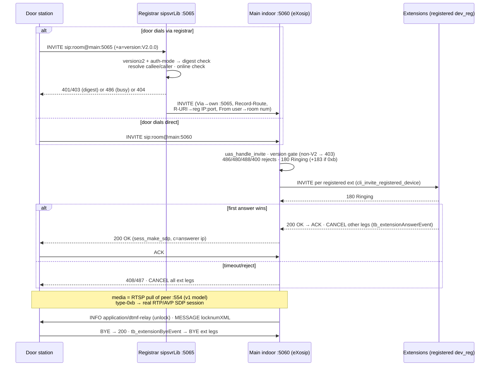

# Doorbell call flow — firmware internals (V2.2.100)

How `hicore` V2.2.100 handles a door call — the V2 counterpart of
[`../firmware/door-call-flow.md`](../firmware/door-call-flow.md). The port
split is unchanged (eXosip UAS :5060, sipsvrLib :5065, RTSP :554, visNet
:8102), but the registrar is now a C++ proxy that rewrites headers and can
digest-challenge INVITEs, and the client enforces a SIP2.0 version gate on
incoming offers.

Sources: `VDM10_2.0/human_readable/sip/client/{uas,session_ctrl,call_out,
messages,device_helpers}.c`, `sip/server/{proxy,dispatch,reply}.c`,
`sip/talkback_tables.c`, `net/net_netservice_rtpsession_talkbackrtpsession.c`.

## 1. Inbound INVITE — `uas_handle_invite` @0x00141e14 (`sip/client/uas.c`)

`cli_ua_task` @0x00143340 dispatches EXOSIP_CALL_INVITE (event 5).
Gates, in order (all verified in decompile):

- Missing To/From username → early exit; `vis_pred_a_q()` +
  `cli_flags_bit19_get()` gate; `FUN_00163210(from_num,0)==0xd` selects the
  visNet/CVBS fast path (extension-pickup `cvbs_extension_pickup(1)` +
  direct 200 with `sess_make_sdp`).
- `eXosip_get_remote_sdp` fails → `488` (0x1e8).
- **SIP2.0 version gate**: `sdp_message_attribute_get(sdp,-1,3)` is
  `strncmp`'d against a 13-char prefix (the `a=version:V2.` form); when the
  offer is *not* V2 and `vis_pred_d_q()==0` (SIP2.0-only device) → `403`
  (0x193). **unverified**: exact prefix text beyond the 0xd length.
- Call classification: `FUN_00163210(from_num,bVar)` → `sess+0x90`
  (door/room/… classes; `==2` promoted to 7 when the caller is an 11-char
  number; local-origin check `sip_client_check_request_origin_is_local`
  @0x00127410 can force class 6).
- DND/time window (`cli_call_datetime_parse`) or contact-blacklist hit →
  `480` (0x1e0); GUI busy/not-ready → `486` (0x1e6); session claim failure →
  400.
- On accept: `eXosip_call_build_answer(0xb4)` + `sess_make_sdp` → `180`;
  class `0xb` additionally sends `183` (0xb7) with SDP. Then
  `sip_client_claim_session_slot` @0x0012778c claims slot 0, stamps
  did/tid/jid, sets the `+600` ringing flag + timers, optional
  `cli_send_incall_msg(1)`, and spawns the ring/call worker thread
  (`uwt_thread_create` — `DAT_00142bf8`/`DAT_00142bfc`, the
  NewCall01/02-equivalent; `cli_call_ring_task` @0x0013b3bc is the ring
  worker; EZVIZ-bound calls pick the cloud-notify variant).

Inbound non-INVITE messages: `uas_call_msg_proc` @0x00142c04; OPTIONS
responses via `cli_options_resp_proc` @0x00139a8c.

## 2. SDP — `sess_make_sdp` @0x00127fa4 (`sip/client/session_ctrl.c`)

Header-only private SDP for intercom calls:

```
v=0 · o=<serial> 0 0 IN IP4 <ip> · s=Talk session · c=IN IP4 <ip> · t=0 0
a=doorFloor:%d  a=responseType:%d  a=doorType:%d
a=isSpecialType:%d  a=isConfirm:%d  a=version:%s
```

`a=version:` selects `V2.0.0` (literal at 0x128ff4) by default, an alternate
compat string (`DAT_00128ff0`, unresolved) in v1-mode paths — the peer
version feeds the §1 gate and `sip_check_peer_version_at_least_two`
@0x0022b6b4 (`V≥2` sscanf on server side).

Class `0xb` (fixed talkback) emits real media SDP:
`m=audio %d RTP/AVP 0 8 101` + `a=rtpmap:0 PCMU/8000`,
`a=rtpmap:8 PCMA/8000`, `a=rtpmap:101 telephone-event/8000`,
`a=fmtp:101 0-16`, `a=sendrecv`, `m=video %d RTP/AVP 96`,
`a=rtpmap:96 H264/90000`, `a=fmtp:96 profile-level-…`. The advertised codec
table (`0x00125dec` region, `sip_client.c`) lists: `0 PCMU/8000`,
`8 PCMA/8000`, `98 G7221/16000` (fmtp bitrate=32000),
`100 MP4A-LATM/16000` (profile-level-id=24;object=23;bitrate=64000),
`104 MP4A-LATM/16000` (object=2;bitrate=64000), `103 G726(-32)/8000`
(bitrate=24000), `115 OPUS/16000` (bitrate=6400) — a superset of the v1
audio set (PCMU/PCMA plus G7221/MP4A-LATM/G726/OPUS; video stays H.264 PT96).
`sess_parse_remote_sdp` @0x00132e20 / `sess_sdp_attr_set` @0x00132b20 parse
the same `a=` vocabulary (`doorFloor`, `doorType` → persisted `cfg+0x6018`,
`isSpecialType`, `isConfirm` → forced class 6, `responseType`).

Outgoing calls: `cli_invite` @0x0013c36c → `cli_send_invite`
@0x00140274 (and `cli_send_invite_voip` @0x00140ca4 for the voip leg),
`cli_call_doorphone` @0x0013b620 for door calls, `cli_invite_registered_device`
@0x00139fa4 for direct INVITE to a registered peer
(`m=audio … RTP/AVP 0 8 101` SDP variant — registered extensions get real
SDP), `cli_ring_proc` @0x00127990 ringback, `cli_cancel_by_num`
@0x0013cd2c, `cli_send_hang` @0x0013ce80, `cli_pickup` @0x0013e1f0 /
`cli_pickup_lm_v2` @0x0013040c, `cli_call_terminate` @0x0013ebf4,
`cli_hang_all_q` @0x0013e774.

## 3. Registrar-side routing — `sip/server/proxy.c`

When the door dials through :5065, `sip_server_route_invite` @0x0022b780:

- Parses `a=version:` out of the body (`strstr`); `V≥2` + auth-mode==1 →
  same 401/403 digest challenge as REGISTER (realm `Hikvision`,
  `sip_build_digest_challenge` @0x0022af50).
- Resolves callee: `sipsvr_resolve_device_record` @0x00230ee4 (own name →
  manager record; else addressbook) → `0x194` if absent; caller must also
  resolve (`sip_addressbook_resolve_destination` @0x002311a0) → `0x194`.
- Busy/online check on both records (`sip_device_is_online` @0x00230ddc)
  → `0x1e6` (**486**) or drop with `sip_device_mark_idle`.
- Forward: clones top Via, rewrites it to own listen IP:port, adds
  `Record-Route: sip:<own>:<port>`, decrements Max-Forwards, rewrites the
  R-URI host:port to the registered device IP:port, and rewrites the
  **From username to the room longNum** (`sip_sdk_query_room_number`
  @0x002252c0) when the callee is the manager/self name — the v2 equivalent
  of the v1 `1000000000` contact patch.
- `sip_server_route_ack` @0x0022cfb4 / `sip_server_route_bye_or_cancel`
  @0x0022f20c / `sip_server_route_message` @0x0022dc6c /
  `sip_server_route_response` @0x0022d598 do the same lookup+rewrite for
  the rest of the dialog/transaction traffic; dispatch in
  `sip_server_dispatch_method` @0x00228d68.

`dispatch_action==1` in `sip_server_process_packet_work_item` @0x00227fb4
broadcasts a copy to **every online registered device** at port `0x13c4`
(5060) — the extension fan-out primitive (used by MESSAGE/notification
fan-out; call fan-out itself is per-device INVITE from the client leg).

## 4. Extension fan-out — `sip/talkback_tables.c` + client INVITEs

- `tb_extensionTask` @0x0011d208 consumes the extension event mq;
  `tb_extensionAnswerEvent` @0x0011cb84 / `tb_extensionCancelEvent`
  @0x0011cd90 / `tb_extensionByeEvent` @0x0011ced0 handle
  first-answer-wins leg teardown and BYE propagation (same event model as
  v1's EXTENSION_ANSWER/CANCEL/BYE).
- NAT/dual-NIC: `tb_masq_rule_table_fill` @0x000cc8d0,
  `tb_talkback_nat_apply` @0x000cc9fc / `tb_talkback_nat_remove`
  @0x000ccb5c, `tb_createRoute` @0x0011c66c / `tb_closeRoute` @0x0011c894 /
  `tb_routeCheck` @0x0011c938 / `tb_extension_routes_clear` @0x0011c930.
- Per-extension legs are ordinary client INVITEs
  (`cli_invite_registered_device` @0x00139fa4) to the registered IP —
  the registered endpoint set now comes from the sipsvrLib
  addressbook/dev_reg instead of the v1 5-slot table.

## 5. In-call control — DTMF/INFO/MESSAGE

- `cli_send_dtmf` @0x0012cd60 — INFO `application/dtmf-relay`
  (`Signal=<d>`, `Duration=160`-style body as in v1).
- `cli_send_incall_msg` @0x0012d3b0 / `cli_send_call_info` @0x0012c080 —
  in-call MESSAGE payloads via the v2 XML vocabulary
  (`xml_getSipInfoXml_v2` @0x00120138; locknum via
  `sip_xml_build_lock_number_message` @0x0011f09c —
  `<locknumXML><lockNum>` + lock-mode element).
- Unlock during call can also go through the visNet/remote paths
  (`cli_unlock_remote_v2` @0x0012e548 — see
  [`doorbell-pairing.md`](doorbell-pairing.md) §5); DTMF-vs-visNet choice
  is the `cli_lock_op_q`/`cli_lock_a_q` helpers @0x0012a898/0x0012ba70.
- Session timers/state: `cli_session_ctrl_task` @0x001414b8 +
  `cli_session_proc_q` @0x0013af80 + `cli_talking_chk` @0x001383c0 +
  `cli_call_state_get_q` @0x001384d4 + `cli_in_call_q` @0x00139a34;
  teardown `cli_free_sip_session` @0x001308d0 / `cli_free_session_idx`
  @0x0013ed38; shared call flags via `cli_vistalk_state_set`/
  `cli_vistalk_busy_get`/`cli_vistalk_mode_get` @0x0012d374/0x0012d390/
  0x0012d3a0 (GUI `gui/windows/oversee.c`, EZVIZ `ezviz_app_stream.c`,
  and the RTP talkback session `net_netservice_rtpsession_talkbackrtpsession.c`
  gate on `busy`/`mode==2`).

## 6. Sequence

<!-- mermaid: fwv2-door-call -->


## 7. Marked unverified

- Whether doors dial :5060 direct vs :5065 (both paths exist; selection
  is a door-side choice, not visible in this binary).
- The 0xd `a=version:` prefix text (V2.0.0 form inferred from the 13-char
  strncmp + the `V2.0.0` literal in `sess_make_sdp`).
- Door-side pull of the answering unit's :554 (mechanism parity with v1
  assumed; door code not in this image).
- Exact response code the eXosip layer emits for a local user-reject.
- Which of the two ring-worker entry points (`DAT_00142bf8`/`0x142bfc`)
  corresponds to v1's NewCall01 vs NewCall02 split — the
  EZVIZ-configured predicate picks between them as in v1.
- `cli_flags_bit19`, `vis_pred_*`, `cli_call_datetime_parse` window
  semantics — flag names kept, cfg meanings unresolved.

## Key functions

| Function | Address | File | Role |
|---|---|---|---|
| `cli_ua_task` | 0x00143340 | `sip/client/uas.c` | :5060 eXosip loop, `HKVS/2.0.0` UA |
| `uas_handle_invite` | 0x00141e14 | `sip/client/uas.c` | INVITE gates + 180/183 + session claim + ring worker |
| `uas_call_answer` / `uas_call_msg_proc` | 0x00141a24 / 0x00142c04 | `sip/client/uas.c` | answer build / in-call inbound msgs |
| `cli_options_resp_proc` | 0x00139a8c | `sip/client/uas.c` | OPTIONS liveness |
| `sess_make_sdp` / `sess_parse_remote_sdp` / `sess_sdp_attr_set` | 0x00127fa4 / 0x00132e20 / 0x00132b20 | `sip/client/session_ctrl.c` | private SDP emit/parse |
| `cli_session_ctrl_task` / `cli_session_proc_q` / `cli_free_sip_session` | 0x001414b8 / 0x0013af80 / 0x001308d0 | `sip/client/session_ctrl.c` | in-call timers/teardown |
| `cli_invite` / `cli_send_invite` / `cli_send_invite_voip` / `cli_invite_registered_device` / `cli_call_doorphone` | 0x0013c36c / 0x00140274 / 0x00140ca4 / 0x00139fa4 / 0x0013b620 | `sip/client/call_out.c`, `device_helpers.c` | outgoing INVITE variants |
| `cli_call_ring_task` / `cli_ring_proc` | 0x0013b3bc / 0x00127990 | `sip/client/call_out.c` | ring worker / ringback |
| `cli_send_dtmf` / `cli_send_incall_msg` / `cli_send_call_info` | 0x0012cd60 / 0x0012d3b0 / 0x0012c080 | `sip/client/call_out.c` | INFO/MESSAGE in-call |
| `cli_cancel_by_num` / `cli_send_hang` / `cli_pickup` / `cli_call_terminate` | 0x0013cd2c / 0x0013ce80 / 0x0013e1f0 / 0x0013ebf4 | `sip/client/call_out.c` | cancel/hang/answer/end |
| `cli_vistalk_state_set` / `cli_vistalk_busy_get` / `cli_vistalk_mode_get` | 0x0012d374 / 0x0012d390 / 0x0012d3a0 | `sip/client/device_helpers.c` | shared call-state flags |
| `sip_server_route_invite` / `route_ack` / `route_bye_or_cancel` / `route_message` / `route_response` | 0x0022b780 / 0x0022cfb4 / 0x0022f20c / 0x0022dc6c / 0x0022d598 | `sip/server/proxy.c` | :5065 proxy + header rewrite + digest gate |
| `sip_check_peer_version_at_least_two` | 0x0022b6b4 | `sip/server/proxy.c` | `V≥2` check for INVITE auth |
| `tb_extensionTask` / `tb_extensionAnswerEvent` / `tb_extensionCancelEvent` / `tb_extensionByeEvent` | 0x0011d208 / 0x0011cb84 / 0x0011cd90 / 0x0011ced0 | `sip/talkback_tables.c` | extension fan-out events |
| `tb_createRoute` / `tb_routeCheck` / `tb_masq_rule_table_fill` | 0x0011c66c / 0x0011c938 / 0x000cc8d0 | `sip/talkback_tables.c` | dual-NIC NAT routes |
