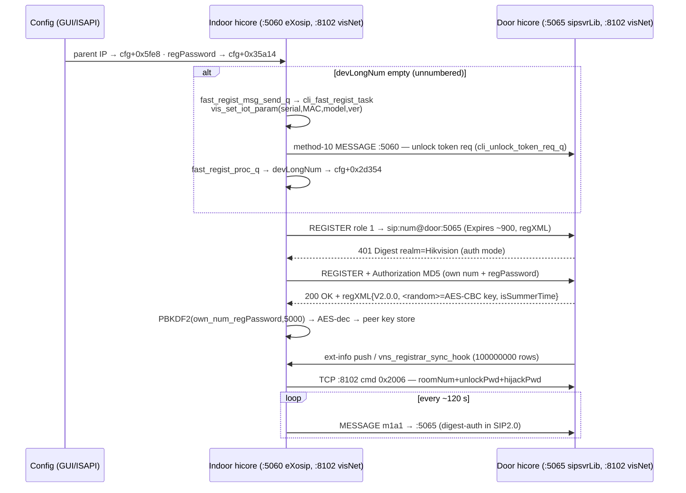

# Doorbell pairing & door↔indoor signaling — firmware internals (V2.2.100)

How `hicore` V2.2.100 pairs an indoor station with an outdoor **door
station**: registration roles, the `fast_regist` provisioning path, unlock
credentials, and the visNet TCP :8102 channel — the V2 counterpart of
[`../firmware/doorbell-pairing.md`](../firmware/doorbell-pairing.md).
Registration mechanics: [`intercom-registration.md`](intercom-registration.md).

Sources: `VDM10_2.0/human_readable/sip/client/{registration,registration_keys,
door_control,messages,xml_messages,device_helpers}.c`,
`VDM10_2.0/human_readable/visnet/server.c`, `VDM10_2.0/human_readable/sip/
xml_proc.c`, `VDM10_2.0/human_readable/sip/server/{registrar,credentials}.c`.

## 1. Pairing model — who registers where

Same tree topology as v1; every inner device has a configured parent. The
registering identity is now always the **From-URI username** (the 11-digit
`devLongNum`, `cfg+0x2d354`).

| Device | Parent cfg | Registers to | Role | visNet target |
|---|---|---|---|---|
| door station (outdoor) | — (root) | — | — | indoors (accepts) |
| main indoor | main door `cfg+0x5fe8` | door `:5065` (role 1); door SIP acct `cfg+0x35000` (role 9) | + own `devLongNum` auth | door `:8102` |
| indoor extension | main indoor `cfg+0x5fd0` | main indoor `:5065` (role 2) | + `devLongNum` + regPassword | main indoor `:8102` |
| again (secondary) door link | `cfg+0x601c` | role 10 | — | — |
| main-room (extension-as-master) | `cfg+0x6034` block | role 8 (name update, 600 s expiry) | — | — |

`cli_regist_task` @0x001347f8 (`sip/client/registration.c`) drives all five
roles; failure of any role → `cli_unreg_to_door(role)` + shortened retry.
**SIP2.0 difference:** the parent now challenges with Digest when running in
authentication mode (`intercom-registration.md` §3); the credential is the
*station's own* Registration Password (`cfg+0x35a14`) for own-number
registration, or a per-peer DB password for extension numbers
(`sip_lookup_registration_password` @0x00119bb8,
`sip/server/credentials.c`). The GUI **Registration Password is mandatory**
for the own-number branch — a zero-length lookup rejects the REGISTER.

## 2. Number assignment — `fast_regist`

The v1 "Pre-Regist" SIP MESSAGE flow is replaced by the `fast_regist`
machinery (`sip/client/registration.c`):

- `cli_fast_regist_task` @0x00126654 — owns the FastRegistMsg mq; 4-byte
  codes 0–3 call `vis_set_iot_param{,_manager}` with device-info fields
  (indexes 1/2/4/6 = serial/MAC/model/version block, own number from
  `cfg+0x2d354`) pushed toward door/manager/again peers. Dedup: repeat
  counts per code are tracked in a small table.
- `fast_regist_msg_send_q` @0x00126018 — posts codes 0–3; no-op when
  `vis_num_layout_q()!=0` (numbered layout already). Called on digest
  rejection (403) and other registration-clearing paths in `cli_reg_resp`
  @0x00133990 — i.e. a failed SIP2.0 registration re-arms the
  provisioning exchange.
- `fast_regist_proc_q` @0x00126a14 — derives own `devLongNum` from cfg
  number fields (bounds: type ≤9, floor ≤998, unit ≤98, room ≤998,
  index ≤98; format selected by `vis_num_layout_q()`) and persists to
  `cfg+0x2d354` + `write_device_parameters()` when the slot is empty or
  stale.

`vis_set_iot_param`'s wire carrier is now verified (pass23): it calls
`sdk_client_set_iot_channel`/`sdk_client_set_iot_subdoor_param`/
`sdk_client_modify_iot_channel`/`sdk_client_set_confirm_device_id` over
the door-SDK login session (handles at cfg `+0x88f0`/`+0x8910`), which send
ISAPI JSON **`POST /ISAPI/System/IOT/channels?format=json`** (add) and
**`PUT /ISAPI/System/IOT/channels/%d?format=json`** (modify) — the
`GetIOT_channelStatus`/`SearchIOT_channel`/`DeleteIOT_channel` siblings use
`GET`/`POST …/status`/`DELETE` URLs on the same channel. The pushed record
carries the device-info block **and** a copy of the station regPassword
from `cfg+0x35a14` — the mechanism by which the door learns the indoor's
digest credential. The `devLongNum` itself is **derived locally** by
`fast_regist_proc_q`; no door-assigned-number path was found (door
assignment remains unproven).

`cli_get_door_reg_key` @0x0012e1cc sends a method-7 message
(`local_1374=7`, port `0x13c4`) to the door block at `cfg+0x5fe8` (or
`cfg+0x601c` via the door-table lookups) containing the serial —
the door-side registration-key provisioning request; the response stores
the door's registration material for later `<random>` decryption (§5).

## 3. devLongNum construction & the type-1 gate

`devLongNum` = 11 digits `T FFF UU RRR II`, classified by
`sip_classify_and_split_device_number` @0x0023b194
(`sip/server/numbering.c`; full table in
[`intercom-registration.md`](intercom-registration.md) §5):

- `unit!=0 && room==0` → type **1 — DOOR**. On a type-1 registrar in
  compat mode, a *non-type-1* peer must share the local `T/FFF/UU` site
  fields or is rejected **410** (`sip_server_register_device` @0x002291b8).
- `unit!=0 && room!=0` → type **3 — ROOM**; `100000000`-prefixed → type 3
  extension numbers (9-char prefix branch).
- Special strings → classes 2/4/6/7/8/10/0xb per scheme branch.

The door class feeds `a=doorType:` in the call SDP
(`sess_make_sdp` @0x00127fa4) and the INVITE routing class via
`FUN_00163210` in `uas_handle_invite` @0x00141e14.

## 4. visNet channel — TCP :8102 (v2 crypto parity)

Wire crypto is **unchanged from v1** (`visnet/server.c`):

- `vns_nonce_gen` @0x0011c2c4 — server nonce = hex-MD5 of
  `"Vis:Hikvision:<asctime>"` (verified literal + MD5 chain; noted as
  cross-version match to v1 `vns_nonceGen` @0x000f51e0).
- `vns_calc_signature` @0x00146778 / `vns_verify_nonce_sign` @0x00149610 —
  frame: `+0x2c` 0x40-byte nonce echo (memcmp against server-issued),
  `+0x6c` signature = hex-MD5 over the frame **with the sig field zeroed**
  (integrity, not a keyed MAC).
- `vns_nonce_key_fold` @0x0011c3b4 — seed constant XOR-folded over nonce
  words → payload key; `vns_payload_xor` @0x0011c460 — u32-wise XOR of the
  payload (`+0xac`).
- `vns_reply_code_send` @0x001495c4 — fixed 0x1c reply `{be32 len=0x1c,
  be32 code}`; 1 = ok.
- `vns_heartbeat` @0x0014984c — keepalive; `visNetServer` @0x0014d62c —
  listener/dispatch (server-side handlers incl. `vns_serv_unlock`
  @0x001482f0, `vns_serv_subdoor` @0x0014a480, `vns_serv_door`
  @0x0014aa08, `visNetServLadder` @0x0001b97c).

Post-registration table sync survives the SIP rewrite:
`vns_registrar_sync_hook` @0x00149530 — called from
`sip_server_control_queue_loop` @0x0011b070 on each registration event —
walks dev_reg rows (0x174-stride records) and for every
`"100000000"`-prefixed `call_num` (`strncmp(row+4, "100000000", 9)`)
invokes `register_extension_device_by_ip(row+0x28)` @0x00146904 — the
extension table push to extensions, now wire-verified (pass23): it
connects to the extension's visNet `:8102` and sends a fixed
**0x14f0-byte** signed frame with cmd `0x2033` — 0xac header
(len/cmd/proto/devnum/mac + nonce `+0x2c` + signature `+0x6c`), be32
record count `@+0xac`, up to `dev_tbl_count_q()` records of 0x144 bytes
`@+0xb0`, payload XOR-folded with the nonce key. V1 used a 0x420 packet;
v2 grew the frame to 0x14f0. The receiver (`visnet/server.c` command loop
→ `synchronize_visnet_extension_room_information`, self-ID
`visNetServExRoomInfoSync`, @0x0001b7f4) imports the records and calls
`dpi_update_call_record_for_name` @0x000456c0 per row.

## 5. Credentials — unlockPwd / hijackPasswd / regPassword / unlock token

| Mechanism | Direction | Where | Notes |
|---|---|---|---|
| visNet cmd `0x2006` (PASSWD) | indoor → door `:8102` | `vns_client_passwd` @0x0012d810 (`sip/client/registration.c`) | 0xec packet `{room, unlockPwd, hijackPwd}` built from `param_1`/`+0x10`/`+0x1c`; reply code 1 = stored. **Main-indoor-only push** in v1 — the same `netAltRoute`-style gate is present but not re-verified |
| SIP `videoIntercomMsg` methods 2/3 | door↔room | `xml_getSipInfoXml_v2` @0x00120138 (`sip/xml_proc.c`) + `sip_xml_build_command_info` @0x0011f1c4 (`sip/client/xml_messages.c`) | m2a1 `{roomNum,unlockPasswd,hijackPasswd}`; m3a1 `{roomNum,delFlag,delLongNum,floorNum[,sipNum]}` (vocabulary from the builder switch — sender sites for provisioning directions **unverified**) |
| unlock token request | indoor → door | `cli_unlock_token_req_q` @0x0012e024 (`sip/client/door_control.c`) | method **10** MESSAGE to the door (`0x13c4` port literal) with own serial — requests an unlock token before remote unlock |
| remote unlock | indoor → door | `cli_unlock_remote_v2` @0x0012e548 / `cli_unlock_remote` @0x0012fd3c / `cli_send_unlock_sip` @0x0012ce74 (`sip/client/door_control.c`) | `cli_unlock_task` @0x00138160 worker; `cli_unlock_alarm_insert` @0x001367e4 logs the event |
| in-call unlock | SIP dialog | `cli_send_dtmf` @0x0012cd60 / `cli_send_incall_msg` @0x0012d3b0 (`sip/client/call_out.c`) | INFO `application/dtmf-relay` path (see [`door-call-flow.md`](door-call-flow.md) §5) |

`hijackPasswd` semantics (duress unlock + silent alarm) remain
**inferred** from naming, as in v1.

## 6. regPassword provisioning & the `<random>` key

The SIP2.0 credential model has three layers (`intercom-registration.md` §4):

1. `cfg+0x35a14` — the station's own Registration Password (GUI-mandatory):
   used for own-number registrations **and** as half of the `<random>` key.
2. Per-peer DB passwords — `where sip_num = '<num>'` → row `+0x98`.
   Writers verified (pass23): ISAPI `isapi_iot_channel_parse_json`
   @0x0030f9b8 (`regPassword`→`+0x98`, `regNumber`→`+0x78`,
   `userName`→`+0xe8`, `password`→`+0x108`) →
   `dpi_register_roomextension_information` / `dpi_update_roomextension_information`;
   GUI pairing (`gui/devicepairing.c` →
   `database_insert_room_extension_net_information`) writes `+0x98` from
   the station regPassword `cfg+0x35a14`; `vis_set_iot_param` pushes
   `cfg+0x35a14` to the door inside the ISAPI IOT-channel record (§2).
3. Response `<random>` = `base64(AES-128-CBC(zeroIV,
   PBKDF2-HMAC("<user>_<pwd>", 5000), 16-byte random))`
   (`sip_generate_registration_key_base64` @0x00119d74,
   `sip/server/credentials.c`). The random itself is per-peer and cached in
   the registrar's DB row (`sip_load_or_generate_registration_random`
   @0x0011abe4) — so the *key material* is effectively a per-peer session
   secret shared at registration time.

Client-side consumption (`sip/client/registration_keys.c`):
`sip_client_decrypt_credential_registration_key` @0x0012b724 derives the
same key (`PBKDF2` over `"%s_%s" % (cfg+0x2d354, cfg+0x35a14)`, 5000 iters)
and AES-128-CBC-decrypts the received `<random>`;
`sip_client_rotate_registration_random` @0x0012b1d0 keeps current+previous
16-byte randoms per peer class (1/2/8/10);
`sip_client_load_extension_registration_key` @0x0012b088 reads a peer's
stored key hex from the DB row (`+0x100`);
`sip_client_clear_peer_registration_randoms` @0x00131800 zeroes them on
re-registration. Later encrypted MESSAGE/SEP signaling presumably consumes
these — **unverified** which v2 messages are encrypted with the key.

## 7. Extension list & fan-out membership

- Extension numbering is the `100000000`-prefix class (type 3); the
  registrar's dev_reg is queried `where dev_type = 3 order by reg_time desc`
  (`sipsvr_db_dev_regs_query` @0x000859d0) into 0x178-stride records —
  the `sipDevSDK_get_register_list` callback @0x00225490
  (`sip/server/sdk_callbacks.c`) serves this to app code. The bound is now
  verified (pass23): `db_channel_limit` @0x000a1d94 returns **5** when
  `vis_num_layout_q()==0`, else **16** (`0x10`); `dev_tbl_count_q`
  @0x000a1e14 encodes the same 5/16 bound for the `0x2033` push
  (≤16×0x144 records), and `db_find_free_extension_channel` @0x000415f8
  allocates the smallest free channel `1..limit` (−1 when full) for
  `database_insert_room_extension_net_information` (GUI pairing + ISAPI
  IOT-channel inserts). The `0x10`/`0x11` constants in `call_out.c`
  @0x0013e774 are a *different* table (session/msg slots 0–16).
- `cli_send_exroom_info_v2` @0x0012e900 / `cli_push_exroom_info_v2`
  @0x00136198 / `push_exindoor_info` (`sip/client/messages.c`,
  `sip/server/server_control.c`) — extension-info pushes on registration
  events (method-5 family payloads incl. `subDoorInfo` ≤8 records from the
  `sip_xml_build_command_info` m5a7 builder).
- Sub-door enumeration still prefers visNet: `vns_client_subdoor`
  @0x001478e8 (cmd 0x2004 family → `vns_serv_subdoor` @0x0014a480) and
  `vns_client_door` @0x00147c9c; the SIP mirror is the same m5a7
  `<subDoorInfo>` vocabulary.

## 8. Sequence — pairing steady state

<!-- mermaid: fwv2-doorbell-pairing -->

## 9. Key functions

| Function | Address | File | Role |
|---|---|---|---|
| `cli_regist_task` / `cli_send_regist` | 0x001347f8 / 0x00130c50 | `sip/client/registration.c` | role-1/2/8/9/10 register loop + builder |
| `cli_fast_regist_task` / `fast_regist_msg_send_q` / `fast_regist_proc_q` | 0x00126654 / 0x00126018 / 0x00126a14 | `sip/client/registration.c` | FastRegistMsg provisioning + own-num derive |
| `cli_get_door_reg_key` | 0x0012e1cc | `sip/client/registration.c` | method-7 key request to door |
| `cli_unlock_token_req_q` / `cli_unlock_remote_v2` / `cli_send_unlock_sip` / `cli_unlock_task` | 0x0012e024 / 0x0012e548 / 0x0012ce74 / 0x00138160 | `sip/client/door_control.c` | unlock token + remote unlock paths |
| `vns_client_passwd` | 0x0012d810 | `sip/client/registration.c` | visNet 0x2006 unlockPwd+hijackPwd push |
| `vns_nonce_gen` / `vns_md5_sign` / `vns_nonce_key_fold` / `vns_payload_xor` | 0x0011c2c4 / 0x0011c3f4 / 0x0011c3b4 / 0x0011c460 | `visnet/server.c` | visNet crypto (v1 parity) |
| `vns_verify_nonce_sign` / `vns_calc_signature` | 0x00149610 / 0x00146778 | `visnet/server.c` | frame verify/build |
| `vns_registrar_sync_hook` / `register_extension_device_by_ip` | 0x00149530 | `visnet/server.c` | post-reg 100000000-table push |
| `vns_client_unlock` / `vns_client_subdoor` / `vns_client_door` | 0x00146b7c / 0x001478e8 / 0x00147c9c | `visnet/server.c` | unlock relay / subdoor / door list pulls |
| `sip_client_decrypt_credential_registration_key` / `sip_client_rotate_registration_random` / `sip_client_load_extension_registration_key` | 0x0012b724 / 0x0012b1d0 / 0x0012b088 | `sip/client/registration_keys.c` | `<random>` key decrypt + per-peer slots |
| `xml_getSipInfoXml_v2` / `xml_pares_sip_info` / `xml_parse_resp_v2` | 0x00120138 / 0x0011d5f0 / 0x00121b68 | `sip/xml_proc.c` | v2 videoIntercomMsg vocabulary |
| `cli_send_exroom_info_v2` / `cli_push_exroom_info_v2` | 0x0012e900 / 0x00136198 | `sip/client/messages.c` | extension info push |

## 10. Resolved in pass23 / still unverified

Resolved in pass23:

- `vis_set_iot_param` wire carrier — ISAPI JSON `POST/PUT
  /ISAPI/System/IOT/channels[/%d]?format=json` to the door over the
  door-SDK session (`sdk_client_set_iot_*`); `devLongNum` is locally
  derived by `fast_regist_proc_q` — no door-assignment path found
  (unproven, not confirmed).
- `0x2033` wire form — fixed 0x14f0-byte signed visNet TCP frame (v1 was
  0x420): be32 record count `@+0xac` + ≤`dev_tbl_count_q()` records
  ×0x144 `@+0xb0`.
- Extension bound — `db_channel_limit` @0x000a1d94 / `dev_tbl_count_q`
  @0x000a1e14 return 5 (`vis_num_layout_q()==0`) or 16 (`0x10`);
  enforced by `db_find_free_extension_channel` @0x000415f8.
- Per-peer provisioning writers — ISAPI `isapi_iot_channel_parse_json`
  (`regPassword`→row `+0x98`), GUI `devicepairing.c` pairing flow, and the
  `0x2033` sync receiver (see §6/`intercom-registration.md` §4).

Still unverified:

- Which v2 MESSAGE payloads are encrypted with the `<random>`-derived key;
  the decrypt path exists client-side but the consumers were not traced.
- Sender sites for m2a1 password and m5a7 subdoor payloads (vocabulary
  verified in the builder; directions inferred).
- `cli_flag`/predicate semantics (`vis_pred_*`, `vis_aux_*`,
  `vis_num_layout_q`) — used liberally; cfg meanings unresolved as in v1.
