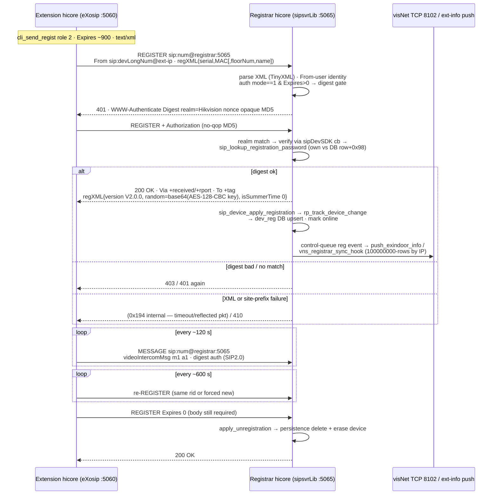

# Intercom registration & private-SIP communication — firmware internals (V2.2.100)

How `hicore` (Metzler VTH 2.2.100 build 251203, rebranded Hikvision indoor
station) registers as an indoor-station/extension, keeps the binding alive,
and resolves peers — the V2 counterpart of
[`../firmware/intercom-registration.md`](../firmware/intercom-registration.md).
The registrar is a **completely different implementation**: the v1 C
`net/sipServer` parser was replaced by a C++ `sipsvrLib` service driving an
embedded osip parser, with a config-gated Digest challenge.

Sources: `VDM10_2.0/human_readable/sip/server/{registrar,credentials,
registration_xml,dispatch,reply,numbering,configuration,addressbook,
address_book,device,persistence,transport,proxy,application,service_mgr,
sdk_callbacks,server_control}.c`, `VDM10_2.0/human_readable/sip/client/
{registration,registration_keys,registrar,heartbeat,uas,session_ctrl,
messages,xml_messages}.c`, `VDM10_2.0/human_readable/sip/xml_proc.c`, and the
authoritative `VDM10_2.0/analysis/registration.md` (verified literals in
`analysis/registration-literals.json`).

## 1. Two SIP stacks, same port split

| Role | Code | Port | Stack |
|---|---|---|---|
| SIP client (UAC+UAS) | `net_sipClient_sip_client.c` — `cli_ua_task` @0x00143340 (`sip/client/uas.c`) | UDP **5060** (`net_util_aux_q(2)`, fallback `0x13c4`) | vendored **eXosip2/osip2**; `eXosip_listen_addr(0x11,0,port,family,0)`; `eXosip_set_user_agent("HKVS/2.0.0")` |
| Registrar/forwarder | sipsvrLib `service_sip_t` — `sip_server_initialize_udp_workers` @0x00226da0 (`sip/server/transport.c`) | UDP **5065** (`net_util_aux_q(1)`, fallback `0x13c9` in `sip_start_server_control_thread` @0x0011c0c4) | own C++ multi-threaded service, embedded `osip_message_parse` |
| visNet sync channel | `visnet/server.c` — `visNetServer` @0x0014d62c | TCP **8102** | proprietary framed protocol, nonce+signature (unchanged crypto, §8) |

`cli_ua_task` spawns ~7 worker threads (registration, session, heartbeat,
message, unlock, fast_regist, transfer) then runs the eXosip event loop:
event 1 → `cli_reg_resp_proc` @0x001318cc, event 2 → `cli_reg_resp`
@0x00133990, event 5 → `uas_handle_invite` @0x00141e14 (`sip/client/uas.c`).

## 2. REGISTER — client packet shape (`sip/client/registration.c`)

`cli_send_regist` @0x00130c50 builds the REGISTER per **registration_role**:

| role | Target | From/To | Expires | regXML |
|---|---|---|---|---|
| 1 | main door `cfg+0x5fe8` :5065 | `From "<cfg+0x120>"<sip:<cfg+0x2d354>@<localip>>`, `sip:<num>@<ip>:5065` | `param_2+300` (≈900; caller passes `vis_aux_e_q()*6+600`) | serial+MAC+`<floorNum>` |
| 2 | sip registrar `cfg+0x5fd0` :5065 | same header scheme | same | serial+MAC |
| 8 | extension/main room `cfg+0x601c`... wait — role 8 targets `cfg+0x6034`-adjacent block (`&DAT_00006034`) :5065 | same | 600 | serial+MAC+`<regDevName>` |
| 9 | door SIP account `cfg+0x35000` :`cfg+0x35040` (dflt 5060) | user `cfg+0x34fac`, auth `cfg+0x34fcc` | `cfg+0x350ce` × 60 | **no body** |
| 10 | again/secondary door `cfg+0x601c` :5065 | same as 1 | same | serial+MAC+`<floorNum>` |

Credentials preloaded with `eXosip_add_authentication_info(user, authuser,
passwd, algo, 0)` before `eXosip_register_build_initial_register` +
`eXosip_register_send_register`; roles 1/2/8/10 use own devLongNum
(`cfg+0x2d354`) for user+auth and the GUI **Registration Password**
(`cfg+0x35a14`); role 9 uses the door-account block (`cfg+0x34fec`).
Re-registration on the same rid reuses `use old_reg_id` path; rid slots per
role at `DAT_00131728+0x68..0x74`. Log names per role: `reg main_door` (1/3),
`reg sip_svr` (2/4/5/6/7), `reg main_room` (8), `reg voip_svr` (9),
`reg again` (10).

Body via `sip_xml_build_registration_identity` (`xml_getRegInfoXml`)
@0x001216ac (`sip/client/xml_messages.c`) — TinyXML-writer output, root
element plus:

```xml
<regDevSerial>…</regDevSerial>          <!-- vis_get_serial, always -->
<regDevMacAddr>xx:xx:xx:xx:xx:xx</regDevMacAddr>  <!-- get_mac_number(iface), always -->
<regDevName>Room 2</regDevName>          <!-- role==8 only, cfg+0x120 -->
<floorNum>3</floorNum>                   <!-- roles 1/10 only: cfg u32/100 or u16 field -->
```

A `<version>` element is **not** emitted in the request body by this builder
(request `<version>` is only ever in the *response*, §4). `Content-Type` set
after `osip_message_set_body` (text/xml literal).

Response handling `cli_reg_resp` @0x00133990: `401`/`407` (0x191/0x197) →
re-add auth info (own-num roles → `cfg+0x35a14`; role 9 → `cfg+0x34fec`) +
per-role retry counters (<10) + `eXosip_default_action`. `403` (0x193) →
clear that role's registered flag, `eXosip_register_remove(rid)`,
`app_videocall_status_changed`, and `fast_regist_msg_send_q(0..3)` to re-arm
provisioning. `404` (0x194) / `410` (0x19a) → same flag clearing + fast_regist
nudges. `cli_reg_resp_proc` @0x001318cc sets the per-role registered bits on
success and reads the `Expires` header twice (response must carry it).

`cli_regist_task` @0x001347f8 is the registration controller: opens its mq,
snapshots `cfg+0x5fd0/0x5fe8/0x601c/0x6034` blocks, computes the re-register
interval `vis_aux_e_q()*6+600` (≈600 s+), calls `fast_regist_proc_q()` once,
then loops on 4-byte mq events (types 1–9 force unreg/re-reg per role) +
timers: role 1 re-REGISTER when `|now−last| > interval`, role 2 likewise
against `cfg+0x5fd0`, role 8 after `> 0x259` s (601 s), role 9 every
`cfg+0x350ce`×45 s (120 s when unconfigured), role 10 for the again door.
Link-down → `cli_unreg_to_door(1,2,8,9,10)`; each failure schedules a
shortened retry (`iVar5−iVar25` countdown ≈ exponential backoff).

`fast_regist_proc_q` @0x00126a14 auto-derives the own `devLongNum` when the
slot is empty: formats `T-FFF-UU-RRR-II`-style fields from cfg (bounds:
type ≤9, floor ≤998, unit ≤98, room ≤998, index ≤98 — format variants
selected by `vis_num_layout_q()`), writes `cfg+0x2d354` under sem +
`write_device_parameters()`.

## 3. Registrar pipeline — `sip_server_register_device` @0x002291b8 (`sip/server/registrar.c`)

Datagram path: `sip_receiver_thread_entry` @0x00226b24 →
`sip_server_receive_and_queue_datagrams` @0x00227d40 → worker
`sip_server_process_packet_work_item` @0x00227fb4 →
`sip_server_parse_and_dispatch_datagram` @0x00228744 (osip parse, sanity:
request needs method or a status 100–699; `osip_message_fix_last_via_header`
stamps `received=<src ip>` + `rport=<src port>`) →
`sip_server_dispatch_method` @0x00228d68 → REGISTER → the handler:

1. **Body parse** — when config `+0x20` getter `sip_config_is_digest_auth_enabled`
   @0x00230a8c returns 0 (the application always writes 0 —
   `sip_start_server_control_thread` @0x0011c0c4; the name is a reading-view
   label, `analysis/registration.md` calls it the *body-skip* getter) →
   `sip_parse_registration_xml_identity` @0x002300e8
   (`sip/server/registration_xml.c`): first body → TinyXML parse → root →
   requires `<regDevSerial>` and `<regDevMacAddr>` with non-null text;
   `<regDevName>` read only when the registrar is *not* device-mode-1;
   `<floorNum>` only when cfg flag `+0x28` (`sipsvr_cfg_flag_0x28_check`
   @0x00230af0). Any failure → internal status `0x194` (404) and an early
   exit that skips response construction — the caller then serializes the
   **original request** (`sip_server_parse_and_dispatch_datagram`), so the
   wire result is a timeout or a reflected REGISTER, **not** a proven 404
   (`analysis/registration.md` correction).
2. **Identity** — the registering number is `From` URI username
   (`request+0x7c→+4→+4`), *not* the v1 To/AOR. Null → `0x194` early exit.
3. **Number gate** — `sipsvr_device_state_read` @0x00230a30 (config `+0x24`,
   the *authentication-mode* byte) == 0 (SIP1.0-compat): classify via
   `sip_classify_and_split_device_number` @0x0023b194; when the registrar is
   device type 1 (`sip_config_is_device_mode_one` @0x0021ef80, config `+0x30`)
   and the peer is not type 1, compare site fields — type byte, floor
   halfword, unit byte (descriptor `+1`,`+2..3`,`+4`) — mismatch → status
   `0x19a` (**410**). Mode 1 (SIP2.0): classification is logged only.
4. **Device record** — `sip_addressbook_find_exact_number` @0x002310a4 on the
   From username; absent → build a `sip_device_record` (C++ object:
   number/name/serial/mac strings + ip/port/type/expire/online) and
   `sip_addressbook_add_device` @0x0021dea8, then `sip_addressbook_resolve_destination`
   @0x002311a0. Insert failure → `0x194`. This in-memory insert does **not**
   provision a credential.
5. **Digest gate** — `Expires` parsed; when auth-mode `+0x24 == 1` **and**
   `Expires > 0`: start status `0x191` (**401**), build quoted realm
   `"<config +0x34>"` (default `Hikvision`), scan Authorization headers for a
   matching quoted realm, verify via `sip_verify_digest_via_device_callback`
   @0x0022aed4 → SDK callback `sip_sdk_verify_authorization_callback`
   @0x002260a8 → `sip_dispatch_sdk_server_event` case 3 @0x0011bb7c →
   `sip_verify_register_digest_authorization` @0x0011b468. Match → 200;
   mismatch → `0x193` (**403**); no matching realm → stays 401.
   `Expires == 0` bypasses the gate (but see §6: the XML parse runs *before*
   Expires is read, so a bodyless unregister still dies at step 1).
6. **Unregister** — status 200 + `Expires == 0` → `sip_device_apply_unregistration`
   @0x0023aec8 (queue persistence event type 0) + `sip_addressbook_erase_device`
   @0x0021e080, all under `sip_addressbook_lock`/`unlock`.
7. **Response** — `sip_server_build_response_from_request` @0x0022a4c4
   (`sip/server/reply.c`): clones To/From/Via/Call-ID/CSeq; adds a random
   `;tag=` (`osip_build_random_number` → sprintf) when To lacks one and
   status ≠ 100; REGISTER replies echo `Expires`; a `Server:` header comes
   from config `+0x40` (default label). Statuses observed in tables:
   `0x191` → `sip_build_digest_challenge` @0x0022af50 adds
   `WWW-Authenticate: Digest realm="Hikvision", nonce=…, opaque=…,
   algorithm=MD5` (nonce = MD5 chain over local ip:port:rand then
   MD5(hex:cseq:callid); opaque = MD5("<time>:")).
8. **On 200 + Expires>0** — `Date` header via `sip_sdk_query_reply_timestamp`
   @0x00225608; `sip_sdk_lookup_registration_random` @0x00225950 →
   `sip_load_or_generate_registration_random` @0x0011abe4 (DB-cached 16-byte
   random at row `+0x100` hex + timestamp `+0x140`, else `/dev/urandom`);
   `sip_sdk_lookup_registration_password` @0x00225828 →
   `sip_lookup_registration_password` @0x00119bb8; secret formatted as
   **`<username>_<password>`** (`%s_%s`, literal-verified); key via
   `sip_sdk_get_encrypted_registration_key` @0x00225a34 →
   `sip_generate_registration_key_base64` @0x00119d74:
   `PBKDF2-HMAC(secret, no salt, 5000 iters, kdf digest)` → 16-byte key →
   `AES-128-CBC(zero IV)` encrypt of the 16-byte random → base64. Response
   body:

   ```xml
   <regXML><version>V2.0.0</version>
   <random>…base64(AES-128-CBC)…</random>
   <isSummerTime>0</isSummerTime></regXML>
   ```

   `Content-Type: text/xml`. Then `sip_device_apply_registration` @0x0023ace0
   (store ip/port/type/serial/mac/name/expires → mark online →
   `rp_track_device_change` @0x00234624 persistence event type 1) and
   `sipsvr_forward_if_online` @0x00230cd0.

## 4. Password selection — `sip_lookup_registration_password` @0x00119bb8 (`sip/server/credentials.c`)

| From/Authorization username | Password source |
|---|---|
| first 11 bytes == own number `cfg+0x2d354` | registration password `cfg+0x35a14`, ≤32 bytes |
| any other | SQL `where sip_num = '<username>'` → record `+0x98`, ≤32 bytes |

Zero-length result → reject (no empty-password fallback). Verifier
`sip_verify_register_digest_authorization` @0x0011b468 additionally requires
Authorization username == From username and nonce/opaque/realm/response/uri/
username all present, then computes the classic **no-qop MD5** digest
(HA1=`MD5(u:r:p)`, HA2=`MD5(m:uri)`, response=`MD5(HA1:nonce:HA2)`). The
apparent md5-sess branch compares the *literals* `MD5` and `md5-sess` —
always false, dead code; **do not claim md5-sess support** (literal-verified,
`analysis/registration-literals.json`). No issued-nonce comparison was seen
— bounded static observation.

Provisioning model: the GUI **Registration Password** (`cfg+0x35a14`)
authenticates only registrations of the station's own number; each
extension/peer SIP number needs its own DB row (`sip_num` → password at
`+0x98`). The writer side (GUI/ISAPI provisioning) was not traced —
`analysis/registration.md`.

## 5. Numbering — `T FFF UU RRR II` (`sip/server/numbering.c`)

`sip_classify_and_split_device_number` @0x0023b194 zeroes a 10-byte
descriptor then branches on `sip_config_get_numbering_scheme` @0x00230ac8
(config `+0x1c`, application default **10**). Schemes 10/11 share one branch;
all other values another. Both branches `sscanf` the same literal
`%01d%03d%02d%03d%02d` — the scheme selector is **not** a 10-vs-11-digit
length distinction (literal-verified).

- `unit != 0 && room == 0` → device type **1** (door).
- `unit != 0 && room != 0` → type **3** (room); with cfg flag `+0x28` set, a
  re-split writes index into `+8` and zeroes `+6..7`.
- `unit == 0 && floor == 0`: `room == 1` → idx 0 → 8, idx <0x33 → 7,
  idx <100 → 2; `room == 2` → 4.
- Special strings (scheme-10/11 branch): two 6-char prefixes → 10 / 0xb;
  exact-match string → 10. Non-10/11 branch: exact strings → 6 and 2;
  9-char prefix → 3 (the `100000000` extension prefix in v1 terms —
  literal targets not re-resolved here, **unverified**).

## 6. Timing & keepalive

| Timer | Where | Value |
|---|---|---|
| `Expires:` sent | `cli_send_regist` | `param_2+300` ≈ **900 s** (roles 1/2/8/10); `cfg+0x350ce`×60 (role 9); role 8 uses literal 600 |
| Re-register | `cli_regist_task` loop | `|now−last| > vis_aux_e_q()*6+600` (≈600 s+); role 9: `cfg+0x350ce`×45 s or 120 s; mq-forced on reg events |
| Heartbeat | `cli_heartbeat_task` @0x00133668 | every `> 0x77` s ≈ **120 s**; skipped while net down, devLongNum ≠ 11 chars, or `sip_peerConnect(cfg+0x5fd0) != 0` |
| Registrar freshness | `sip_addressbook_expire_heartbeats` @0x0021c82c (`abm_check_hb_timeout`) + `sip_device_decrement_expiry` @0x0021f68c | per-record expiry decremented on the addressbook worker; `sip_device_get_remaining_expiry` @0x0021f4f8 |

Heartbeat body: `cli_heartbeat_task` fills the 0x1368 `videoIntercomMsg`
block (method 1, action 1, `deviceSN`=serial, from-ip=own, to-ip=`cfg+0x5fd0`
block, `num`=own `cfg+0x2d354`) and sends via `cli_send_sip_cmd`. Failure →
clears the registered state, `app_videocall_status_changed(9)`,
`sip_client_post_registration_event(5)` (`sip/client/registrar.c`
@0x00133634). **SIP2.0 note:** `cli_send_msg_v2` @0x0012c1ec sends MESSAGEs
to `sip:<num>@<ip>:<port>` with default port `0x13c9` (**5065** — the
registrar, not 5060) and pre-adds digest auth (`cfg+0x2d354`/`cfg+0x35a14`);
it then waits on a per-(method,action) channel-table flag
(`cli_msg_auth_q` @0x0012bf84 set by the response path
`cli_sip_info_resp_proc` @0x001368f8) up to 500×10 ms.

## 7. dev_reg persistence

In-memory records live in the addressbook manager (`std::map`-keyed C++
device objects); durable rows are written through the persistence worker:

- `rp_track_device_change` @0x00234624 → `rp_work` /
  `sip_registration_persistence_flush_events` @0x00234a10 (register_persistence):
  event type 1 → `dpi_register_device_registration_information` (insert),
  type 0 → delete path; `sip_dispatch_sdk_server_event` @0x0011bb7c handles
  DB ops directly: case 0 insert, case 1 `database_delete_dev_registration_information`
  (`where call_num='%s' or dev_ip='%s'`), case 2
  `dpi_update_device_registration_information(rec,5)`, case 4 →
  `sipsvr_sdk_field_store_locked` (status field).
- `sip_store_registration_key_in_database` @0x0011a108 also writes the
  generated key into the peer's registration row (`+0xc0`, flag 4).
- On boot, `sip_addressbook_load_registrations` @0x0021d590 re-imports rows
  (`sip_addressbook_import_runtime_record` @0x0021cfb8);
  `sip_insert_local_manager_registration` @0x0011aebc seeds the local
  manager record; `sipsvr_db_dev_regs_query` @0x000859d0 lists rows
  `where dev_type = %d order by reg_time desc` (0x178-stride records — the
  same layout the `sipDevSDK_get_register_list` callback @0x00225490 serves).
- Post-register sync: `sip_server_control_queue_loop` @0x0011b070 (mq
  0x178 msgs, type 0 = registration event) → DB insert + name update +
  `push_exindoor_info()` or `vns_registrar_sync_hook` @0x00149530 — the
  latter walks dev_reg rows (0x174 stride) for `100000000`-prefixed numbers
  and calls `register_extension_device_by_ip(row+0x28)` per row
  (`visnet/server.c`; net effect matches the v1 :8102 table push —
  transport details in [`doorbell-pairing.md`](doorbell-pairing.md) §4).

## 8. Busy / session state

There is **no** `g_callBusy` flag in the new registrar — the old
`sip_udpProcRule` writer is gone. Instead:

- `sip_server_route_invite` @0x0022b780 checks `sip_device_is_online`
  @0x00230ddc on both caller and callee records; a busy/offline endpoint →
  `0x1e6` (**486**) via `sip_sdk_attr7_flag_get`-gated path, or `0x194`.
- Client side: `cli_vistalk_busy_get` @0x0012d390 / `cli_vistalk_mode_get`
  @0x0012d3a0 / `cli_vistalk_state_set` @0x0012d374
  (`sip/client/device_helpers.c`) — the visTalk session state read by GUI
  (`gui/windows/oversee.c`), EZVIZ (`ezviz_app_stream.c`) and the RTP
  talkback session (`net_netservice_rtpsession_talkbackrtpsession.c` —
  `mode==2` gates).
- `uas_handle_invite` @0x00141e14: GUI-not-ready → `0x1e6` (486), DND/time
  window → `0x1e0` (480), no/unparseable SDP → `0x1e8` (488), session
  alloc failure → 400, and **SIP2.0 peer-version gate** — the 4th SDP
  attribute (`sdp_message_attribute_get(…,−1,3)`) is `strncmp`'d against a
  13-char prefix (`a=version:V2.` shape); a non-V2 offer from a SIP2.0-only
  device → `0x193` (**403**). `sess_make_sdp` emits `a=version:V2.0.0` by
  default (`sip/client/session_ctrl.c` @0x00127fa4; the alternate
  compat-version string is **unverified**).
- Proxy INVITEs through :5065 get the same digest treatment:
  `sip_server_route_invite` extracts `a=version:…` from the body
  (`strstr`), `sip_check_peer_version_at_least_two` @0x0022b6b4 requires
  `V≥2`; qualifying peers under auth mode get challenged 401/403 identically
  to REGISTER.

## 9. Sequence — register, heartbeat, unregister

<!-- mermaid: fwv2-registration -->


## 10. Key functions

| Function | Address | File | Role |
|---|---|---|---|
| `cli_ua_task` | 0x00143340 | `sip/client/uas.c` | eXosip :5060 init (`HKVS/2.0.0` UA), worker spawn, event dispatch |
| `cli_send_regist` | 0x00130c50 | `sip/client/registration.c` | REGISTER builder roles 1/2/8/9/10 |
| `cli_regist_task` | 0x001347f8 | `sip/client/registration.c` | registration controller, mq + timers + unreg |
| `cli_reg_resp` / `cli_reg_resp_proc` | 0x00133990 / 0x001318cc | `sip/client/registration.c` | 401→re-auth, 403/404/410→clear+fast_regist, success flags |
| `cli_fast_regist_task` / `fast_regist_msg_send_q` / `fast_regist_proc_q` | 0x00126654 / 0x00126018 / 0x00126a14 | `sip/client/registration.c` | FastRegistMsg mq → `vis_set_iot_param`; own-number derivation |
| `cli_heartbeat_task` | 0x00133668 | `sip/client/heartbeat.c` | ~120 s m1a1 MESSAGE keepalive |
| `cli_send_msg_v2` | 0x0012c1ec | `sip/client/messages.c` | SIP2.0 MESSAGE → :5065 + digest + response wait |
| `sip_xml_build_registration_identity` (`xml_getRegInfoXml`) | 0x001216ac | `sip/client/xml_messages.c` | regXML request builder |
| `xml_getSipInfoXml_v2` / `xml_pares_sip_info` | 0x00120138 / 0x0011d5f0 | `sip/xml_proc.c` | v2 message XML builder / parser |
| `sip_client_decrypt_credential_registration_key` | 0x0012b724 | `sip/client/registration_keys.c` | PBKDF2(5000) → AES-128-CBC dec of `<random>` |
| `sip_client_rotate_registration_random` / `sip_client_load_extension_registration_key` | 0x0012b1d0 / 0x0012b088 | `sip/client/registration_keys.c` | per-peer random slots / DB random hex decode |
| `sip_server_initialize_udp_workers` / `sip_receiver_thread_entry` / `sip_sender_thread_entry` | 0x00226da0 / 0x00226b24 / 0x00227760 | `sip/server/transport.c` | UDP worker pool bind/send/recv |
| `sip_server_process_packet_work_item` | 0x00227fb4 | `sip/server/dispatch.c` | work-item → dispatch → reply/broadcast/forward enqueue |
| `sip_server_parse_and_dispatch_datagram` | 0x00228744 | `sip/server/dispatch.c` | osip parse + last-Via fix + serialize |
| `sip_server_dispatch_method` | 0x00228d68 | `sip/server/dispatch.c` | method strcmp → REGISTER/INVITE/ACK/BYE/CANCEL/MESSAGE/response |
| `sip_server_register_device` | 0x002291b8 | `sip/server/registrar.c` | REGISTER end-to-end |
| `sip_parse_registration_xml_identity` | 0x002300e8 | `sip/server/registration_xml.c` | TinyXML body → serial/MAC/(name)/(floor) |
| `sip_verify_register_digest_authorization` | 0x0011b468 | `sip/server/credentials.c` | no-qop MD5 verify |
| `sip_lookup_registration_password` | 0x00119bb8 | `sip/server/credentials.c` | own regPassword vs DB `sip_num` row+0x98 |
| `sip_generate_registration_key_base64` | 0x00119d74 | `sip/server/credentials.c` | PBKDF2-5000 → AES-128-CBC → base64 `<random>` |
| `sip_build_digest_challenge` | 0x0022af50 | `sip/server/credentials.c` | nonce/opaque generation + WWW-Authenticate |
| `sip_server_build_response_from_request` | 0x0022a4c4 | `sip/server/reply.c` | response clone/tag/Expires/Server header |
| `sip_classify_and_split_device_number` | 0x0023b194 | `sip/server/numbering.c` | T FFF UU RRR II → 10-byte descriptor |
| `sipsvr_config_load_defaults` | 0x0023bd98 | `sip/server/device.c` | port 0x13c9, timers 600/900, realm `Hikvision` |
| `sip_start_server_control_thread` | 0x0011c0c4 | `sip/server/server_control.c` | config block → start wrapper/run; auth byte = `vis_aux_f_q()==0` |
| `sip_device_apply_registration` / `sip_device_apply_unregistration` | 0x0023ace0 / 0x0023aec8 | `sip/server/device.c` | endpoint store + online mark + persistence event |
| `rp_track_device_change` / `sip_registration_persistence_flush_events` | 0x00234624 / 0x00234a10 | `sip/server/persistence.c` | dev_reg DB insert/update/delete queue |
| `sip_dispatch_sdk_server_event` | 0x0011bb7c | `sip/server/server_control.c` | sipDevSDK cb dispatch: DB ops / digest verify / status |
| `sip_server_control_queue_loop` | 0x0011b070 | `sip/server/server_control.c` | reg-event mq → DB insert + ext-info push |
| `sip_server_route_invite` / `route_ack` / `route_bye_or_cancel` / `route_message` / `route_response` | 0x0022b780 / 0x0022cfb4 / 0x0022f20c / 0x0022dc6c / 0x0022d598 | `sip/server/proxy.c` | proxy forward + header rewrite (+INVITE digest) |
| `sipsvr_config_is_digest_auth_enabled` (body-skip) / `sipsvr_device_state_read` (auth mode) / `sip_config_is_device_mode_one` | 0x00230a8c / 0x00230a30 / 0x0021ef80 | `sip/server/{dispatch,configuration}.c` | config +0x20/+0x24/+0x30 getters |

## 11. Marked unverified

- **`cfg+0x35e8d` SIP1.0/SIP2.0 factory default** — the auth-mode byte is
  `vis_aux_f_q()==0` where the prior investigation ties the getter to
  `cfg+0x35e8d==1`; the actual device setting is unknown (`analysis/registration.md`).
- **Wire behavior on XML/From failure** — internal `0x194` bypasses response
  build; could be timeout or a reflected request. Needs a capture.
- **Nonce freshness** — no issued-nonce store seen; unverified whether a
  wrapper tracks it.
- **`Expires: 0` unregister in auth mode** — the digest gate only runs for
  `Expires>0`, but the XML body parse runs first; whether an unauthenticated
  unregister with a valid body is honored is unverified.
- **`<version>` alternates in `sess_make_sdp`** — `V2.0.0` literal verified
  at 0x128ff4; the `DAT_00128ff0` compat string unresolved.
- **regXML `<version>` in requests** — parser doesn't require it; the
  request builder emits serial/MAC(+name/floor) only.
- **Numbering special strings** — the 6/9-char prefixes and exact-match
  labels in both scheme branches weren't re-resolved to text here; the
  `100000000` extension-prefix mapping is inferred from v1 parity.
- **Per-peer DB provisioning path** — read-side `where sip_num='%s'` is
  verified; the GUI/ISAPI writer is not traced (don't invent an endpoint).
