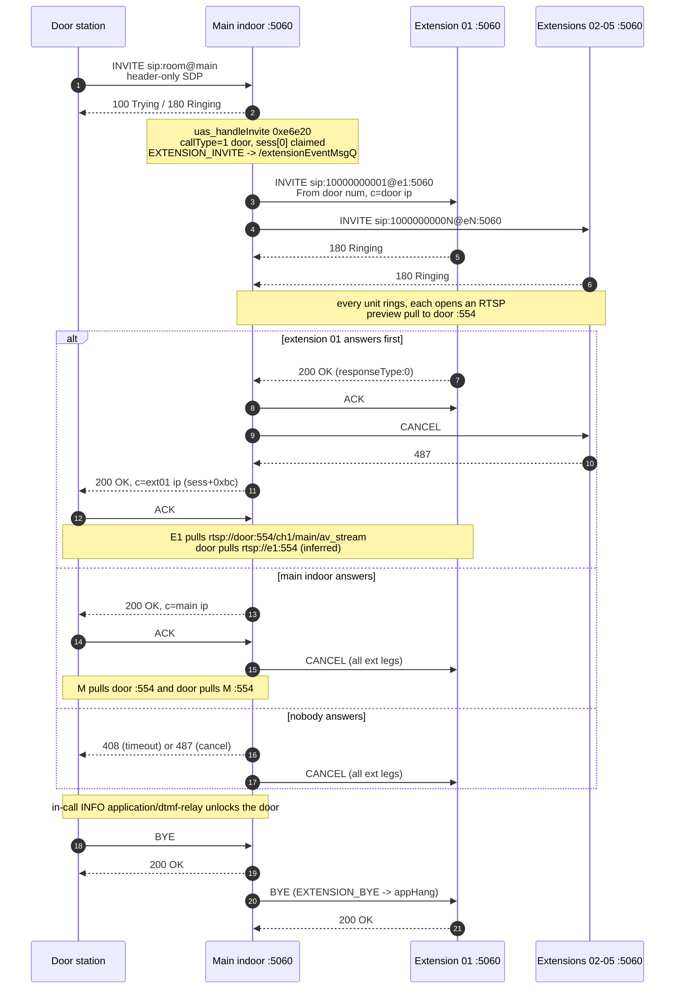

# Doorbell call flow — firmware internals

How `hicore` (Metzler VTH 2.0.24, rebranded Hikvision indoor station)
handles an inbound **door call**: the door station's INVITE at the main
indoor, fan-out to registered indoor extensions, ring/answer/reject/
timeout on every unit, the RTSP-based media, DTMF unlocking, and
teardown. Pairing and registration:
[`doorbell-pairing.md`](doorbell-pairing.md) /
[`intercom-registration.md`](intercom-registration.md); wire dialect:
[`../protocol.md`](../protocol.md).

Sources: `readable/sip/client/{uas.c,uas_calls.c,call_out.c,session_sdp.c}`,
`readable/sip/talkback_tables.c`, `readable/sip/server/*`,
`readable/net/{ipcamera.c,vis_stream.c,rtp_talkback.c}`,
`readable/gui/calls/{accept.c,videocall.c,monitor.c}`, `ANALYSIS.md`
§5/§8/§9. Each claim is marked **verified** (decompile-cited or captured
on the wire) or **inferred**; door-side internals live in the door's own
`hicore` build and are marked where they cannot be confirmed here.

## 1. Components, ports, session table

| port | use |
|---|---|
| UDP 5060 | eXosip UAS on every station — all direct INVITEs land here |
| UDP 5065 | `task_sipServer` registrar — REGISTER and proxied requests only |
| TCP 554 | RTSP on every station — call media is **pulled**, never sent as SIP-RTP |
| UDP 9654/9655 | fixed RTP/RTCP pair, used *only* by call type `0xb` talkback sessions |
| TCP 8102 | visNet proprietary channel (pairing/liveness) — not part of this path |

Roles: the **door station** INVITEs the room and serves its camera/
audio on `:554`; the **main indoor** owns UAS `:5060` + registrar
`:5065`, fans out to extensions, and pulls the door's `:554` while
ringing; **indoor extensions** (registered at `:5065`) receive a direct
INVITE at `:5060`.

Session table `g_sess_tbl` @ `0x00a6c184`: six `0x100`-byte slots —
slot 0 is the "current" call (the door↔main leg on the master; the only
leg on an extension), slots 1–5 hold outgoing extension legs. Key
fields (`uas_calls.c` header): `+0x64/+0x68` did/tid, `+0x70` allocated,
`+0x78` responseType, `+0x7c` callType, `+0x88` peerIp, `+0x98` peerNum,
`+0xac` sdpIp (media target from the remote `c=`), `+0xbc` alternate
`c=` ip for the 200 answer, `+0xcc` isSpecialType, `+0xd0/+0xd4`
audio/video port+PT, `+0xd8/+0xe0` video/audio up, `+0xdc` answered,
`+0xf0` result.

`callType` (`devTypeFromNum` @ `0x000f9ce0`): **1** door, **3** room/
extension (`"1000000000"` prefix), **5** villa door, **6** confirm/
self-loop, **7** ManageCenter, **0xb** fixed-port talkback.
`responseType`: **0** answered, **1** timeout, **2** auto-answer,
**3** rejected, **4** re-notify (`ANALYSIS.md` §9).

## 2. Sequence overview

<!-- mermaid: fw-door-call -->

## 3. The door's INVITE at the main indoor

### 3.1 Intake — `uas_handleInvite` @ `0x000e6e20` (`client/uas.c`)

`task_sipClient_UAS` @ `0x000e8318` dispatches EXOSIP_CALL_INVITE to
`uas_handleInvite`. Whether the door dials `:5060` directly or via the
main's `:5065` registrar (`lookUp` @ `0x000d9658`, `server/reply.c`) is
a door-side choice — both paths exist (verified); the actual selection
is **unverified**. Only the registrar path touches the busy flag
(§3.3).

`uas_handleInvite`, in order (verified):

- **Reject gates**: session active (`sess+0x70`), call in flight,
  `srv_getCallBusy()` (0xda608), or GUI not up → `486 Busy Here` +
  missed-call CDR; same-source-IP repeat → `400`; no SDP → `488`;
  DND → `480`.
- `180 Ringing` (built explicitly; `100 Trying` comes from the eXosip
  transaction layer).
- Classification: `"1000000000"` prefix → 3; `T FFF UU RRR II` with
  unit≠0, room=0 → 1 (door); villa → 5; config-gated → 0xb; then
  `ManageCenter` → 7, self-loop (`call_via_match` → our IP) → 6.
- Parses the header-only private SDP (§3.2), claims slot 0.
- Posts `EXTENSION_INVITE` to `/extensionEventMsgQ` when
  `netAltRoute()!=0` (we are a main indoor), auto-answer gate off,
  callType ∉ {7,0xb}, and the **caller** is not a `"1000000000"` room
  number (an extension's call never re-fans — verified).
- Spawns `task_sipClient_NewCall01` @ `0x000e5fa4` (when `netAltRoute()`
  and storMode==4 or ezviz configured) else `task_sipClient_NewCall02`
  @ `0x000e5a04`. Extensions always run NewCall02.

### 3.2 Private SDP metadata

Door/room signaling carries **no `m=` lines** — the body is a
header-only SDP (`s=Talk session`, private `a=` attrs; full example in
`protocol.md` §5) parsed by `sessParseRemoteSdp` @ `0x000dcf58`
(verified). Consumed fields: `c=` → `sess.sdpIp` (RTSP pull target);
`a=doorFloor` → floor id; `a=doorType` → persisted at `cfg+0x6018` and
echoed onward; `a=isSpecialType` → `sess+0xcc` (GUI suppresses the
remote-video rect on `2`); `a=isConfirm:1` → forces callType 6. The
answer's `a=responseType` reports the outcome (`buildLocalSdp` @
`0x000dd18c`).

### 3.3 Busy gate and extension fan-out

`srv_setCallBusy`/`srv_getCallBusy` (0xda63c/0xda608; flag @ 0x819828,
mutex 0x81985c) is written **only** by `sip_udpProcRule` @ `0x000dabb8`
(`server/sipServer.c`): set when the registrar routes an INVITE for a
`"1000000000"`/`ManageCenter` AOR, cleared on BYE/CANCEL/408/486/603 —
**no timer**, so a wedged call blocks later doorbells at both gates
until a termination message arrives (verified, `ANALYSIS.md` §8).

`tb_sendExtInvite` @ `0x000edd1c` posts `{type=1, doorNum, doorIp,
isSpecialType, isConfirm}` to `/extensionEventMsgQ`; its consumer
`talkBackExtensionPro` @ `0x000edec4` (`talkback_tables.c`) then
iterates every **unexpired** `dev_reg` row with a `"1000000000"`-prefixed
`call_num` (all registered extensions; `ManageCenter` skipped) and:

- `routeCheck` + `createRoute(1, dev_ip, door_ip)` — NAT relay routes,
  **only when `srv_netMode_w()==2` (dual-NIC)**; no-op on LAN.
- `clientCallExt(call_num, dev_ip, doorNum, doorIp, isSpecialType,
  isConfirm)` @ `0x000e4ad8` — a **direct** INVITE from a free slot
  1–5 (max five legs): `INVITE sip:1000000000N@<ext-ip>:5060`,
  `From: sip:<door-num>@<main-ip>`, `Subject: This is a call to app.`,
  SDP `c=<door ip>` (netMode 1), `a=doorType` from `cfg+0x6018`,
  `a=isSpecialType`/`a=isConfirm` echoed from the door's offer.
  Verified on the wire (`ANALYSIS.md` §8, `protocol.md` §5).

**First answer wins.** A 200 on slot *n* (1–5): the main ACKs it,
copies the ext's peerIp into `sess0+0xbc` (so the 200 to the door
carries `c=<ext ip>`), and posts `EXTENSION_ANSWER {ext num}` →
`talkBackExtensionAnswerEvent` appHangs every other leg — CANCELs to
the losing extensions (verified). If the **main** answers, the event
carries its own number, dropping *all* ext legs. A refusal on an ext
leg (`CALL_DECLINED`) runs `notifyDev` @ `0x000eda90`
(=`talkBackExtensionCancelEvent`) + `callTerminateLeg` — the decompile
ends the whole door call then (code-verified, not seen live).

## 4. Ring, answer, timeout at each unit

Each unit's NewCall worker runs the same loop (verified):
`postCallEvent` → GUI **accept** window (`acceptProc` @ `0x00286d68`);
**preview pull during ring** — `openVisStream(sess->sdpIp,0)` @
`0x0007a278` for callTypes ∉ {7,0xb}, so every ringing unit connects to
the door's `:554` immediately; `sessWaitCall` @ `0x000dc2dc` plays the
configured ring (`cfg+0x2d414`, `cfg+0x2d494` ms) and waits — answer
sets `g_callPicked`, reject sets `g_rejectReq`, teardown or the timeout
(`cfg+0x2d4a1`; dual-NIC: `0x3c`/`0xff` by caller class) ends it.
NewCall01 only: auto-answer (`CFG_AUTOANS` && callType ∈ {0,1,4,5,6}
→ responseType 2) without ringing.

| outcome | responseType | wire response |
|---|---|---|
| answer | 0 | `200 OK` + `buildLocalSdp` |
| auto-answer | 2 | `200 OK` (NewCall01 only) |
| reject | 3 | `callTerminateLeg` — eXosip emits the refusal (exact code unverified) |
| timeout | 1 | `408`; on callType ∈ {1,4,5,6} + busy cfg, a `200` with `a=responseType:1` instead (NewCall01 leave-message path) |

The 200 body is header-only except type `0xb`: `o=` own serial,
`c=` own IP — or `sess+0xbc` when answering on an ext's behalf —
`a=responseType` the outcome, `a=isSpecialType`
`(isSpecialModel()==0 || cfgBit9()!=0) ? 0 : 2` (indoors send `2`,
verified live). `ACK` binds `sess+0x64/+0x68`, sets the answered flag,
and arms `taskSipSessionCtrl` @ `0x000e56e4`.

## 5. Media — what actually flows

### 5.1 Verified model: RTSP pulls, not SIP RTP

The SDP carries no ports — media is established by each side **pulling
RTSP** from the peer's `:554` (verified, `ANALYSIS.md` §5):
`openVisStream` (mq msg 3) → `/mq-talkBackVideo` →
`ipc_talkBackVideoProcess` @ `0x00079068` → `ipc_getTalkBackVideo` @
`0x00078d14` → `talkBackOpenStreaming` @ `0x00114acc` →
`openStreamingRtsp` @ `0x001151a0` → `cipcm_streaming_start` @
`0x00115d4c`. URL `rtsp://<ip>:554/ch1/{main,sub}/av_stream`, `admin` +
password credential, DESCRIBE/SETUP/PLAY, RTP **interleaved in the RTSP
TCP connection**. The door advertises H.264 (`trackID=1`, ch 0/1) +
PCMU (`trackID=2`, ch 2/3); an indoor station's server sends only PCMU
on ch 2 despite advertising video (verified — indoor↔indoor calls are
audio-only). The *callee* pulls the caller's `:554` at ring (the
preview); after ACK the peer pulls the answerer's `:554` — this
symmetric pull is the bidirectional-audio mechanism.

### 5.2 Door-call media direction

- **Answerer → door**: `sdpIp` is the door's IP (its `c=` propagated
  through the fan-out offer), so ext/main pull the door directly —
  verified.
- **Door → answerer**: the main's 200 to the door carries
  `c=<answered unit's ip>` via `sess+0xbc`; the door's pull of that
  `:554` is the same post-ACK mechanism — **inferred** (door-side code
  is not in this binary).
- Door RTSP concurrency while the main *and* all extensions ring-pull:
  **unverified** (`ANALYSIS.md` notes these servers appear
  single-client — a wedged pull blocks new connections).

### 5.3 Type-0xb fixed RTP talkback — a different feature

Only `callType==0xb` takes the classic SDP/RTP path: `sessParseRemoteSdp`
accepts real `m=` lines (audio PT {0,2}, video PT `0x60`),
`buildLocalSdp` emits `m=audio 9654 RTP/AVP 0 101`, and
`openTalkbackRtp` @ `0x0007a7f8` commands `/talkBackRtpTask`
(`rtp_talkback.c`): binds UDP **9654**/RTCP **9655**, routes audio to
one socket and PT `0x60` video to a second, PT `0x65` telephone-events
→ DTMF. A persistent door-talkback channel, distinct from the doorbell
call flow (all verified).

## 6. In-call control — unlock

- **DTMF INFO** — `sipcli_unlock_dtmf` @ `0x000df6c0`: SIP INFO,
  `Content-Type: application/dtmf-relay`, body
  `Signal=<d>\r\nDuration=160`, sent on the answering unit's call
  dialog. GUI maps lock button `0x802` → digit `1`, `0x803` → `2` —
  verified in `acc_unlock` @ `0x002868e8`. In-call `vc_unlockDoor` @
  `0x0027bd24` is a recovered stub (only `callParamGet(6)` survived);
  presumably the same helper — **inferred**. Whether the main relays an
  extension's DTMF onward to the door, and the door-side INFO handler,
  are outside this binary (**unverified**).
- **locknum MESSAGE** — `send_locknum_msg` @ `0x000dfa6c` sends
  `<locknumXML><lockNum>n</lockNum></locknumXML>` during incoming-INVITE
  setup when the talkback cfg flag is on; `get_locknum` @ `0x000df918`
  maps the calling door to its lock index (both verified). Incoming
  MESSAGE/OPTIONS are answered by `_client_handle_message` @
  `0x000ddbc8` / eXosip 200s.

## 7. Teardown, cancel, timeout

- **BYE** → `call_handleBye` @ `0x000e7d4c`: `200 OK`,
  `stopAudioDisplay`, `sessFree` @ `0x000df278` (dsp stops,
  `vis_closeStream` @ `0x0007a42c`, `talkbackAltOpen` @ `0x0007a924`
  for 0xb, slot wipe, `g_stop_ring=1`), GUI end event. When the door
  leg ends while an extension answered (`g_ext_idx` set), the main
  posts `EXTENSION_BYE` → `appHang` → BYE on the ext leg — matches the
  live-observed 44–61 s delayed ext-leg BYE (verified code path).
- **CANCEL** → eXosip `200` to CANCEL + `487` to INVITE;
  `CALL_CANCELLED` sets `g_cancel_flag`, waking NewCall's dead-session
  cleanup; the BYE-after-487 path in `call_handleBye` also drops ext
  legs via `notifyDev` (verified).
- **Ring timeout** → `408` + `notifyDev({own num})` → all ext legs
  CANCEL'd (verified).
- `taskSipSessionCtrl` timers: 5 s no-progress, ~63 s no-answer, talk
  limit (`1800`/`cfg+0x2d556`), 120 s `responseType==1` ring cap.

## 8. GUI screens and transitions

- **Incoming call** — `acceptProc` @ `0x00286d68` (`accept.c`): answer
  `0x800`, hangup `0x801`, unlock `0x802/0x803`, snapshot and IPC-list
  buttons, caller name/number/time. `callType ∈ {1,4,5,6,0xb}` marks
  the call video-capable (lock query + door-IPC list); the video area
  paints during ring when `lockNum>0`, fed by the preview pull.
- **Pickup** — `acceptPickup` @ `0x002866fc`: `callParamSet`
  (4=callType, 5=isSpecialType, 6=lockNum, 2=caller name),
  `cancelByNum` (SIP answer cmd @ `0x000e6698`), `vc_openWin` @
  `0x0027d1e4` → **win_videocall** (`videocallProc` @ `0x0027bd9c`).
- **In call** — `videocall.c`: remote-video rect painted **only when
  `isSpecialType != 2`** (param 5 — indoors report `2`, so room calls
  show no video pane while door calls do); hangup → `vc_hangup` →
  `call_clientSendHang`; unlock → `vc_unlockDoor` (§6); zoom only when
  `isSpecialType==3`; far-end-ended (`0x80f`, code 4) destroys the
  window (destroy stops tones/timers, resets params, clears video).
- **Monitor mode** — `monitor.c` (`win_modeselect` @ `0x0027a1f8` →
  `win_watch` @ `0x0027e7e4` → oversee streams `0x0026bedc`/`0x0026bf94`):
  a user-initiated watch pull of a door/IPC camera — **no SIP session**,
  listed to distinguish it from the call screens.

## 9. Verified vs. unverified — summary

**Verified:** UAS intake and codes (100/180/200/400/408/480/486/487/
488, BYE→200); classification + private SDP attrs; mq fan-out to all
registered `1000000000N` rows at `:5060` (`From:<door>`, `c=<door>`,
`Subject: "This is a call to app."`); first-answer-wins with
`EXTENSION_ANSWER`/`EXTENSION_BYE`/`notifyDev` leg cancel; ring-time
RTSP preview; interleaved H.264 + PCMU on `:554`; the `0xb` 9654/9655
talkback as a separate feature; DTMF INFO + locknum MESSAGE; the
accept→videocall chain + `isSpecialType==2` video suppression; the
busy flag's set/clear points and missing timer.

**Inferred / unverified:** which port the door dials (`:5060` direct vs
`:5065` forwarded — both implemented); the door pulling the *answering*
unit's `:554` (mechanism verified, execution not); door RTSP
concurrency during multi-unit ring; the refusal code eXosip emits for
a user reject; ext-leg-decline → whole-call teardown (code-verified
only); `vc_unlockDoor`'s body (stub — `acc_unlock` shows the helper);
main→door relay of extension-sent DTMF; the `"Duc<idx>"` dual-NIC
hangup variant in `acceptHangup`.

## Key functions

| function | address | file | role |
|---|---|---|---|
| `task_sipClient_UAS` | `0x000e8318` | `sip/client/uas.c` | UDP 5060 eXosip event loop |
| `uas_handleInvite` | `0x000e6e20` | `sip/client/uas.c` | INVITE gate → 100/180 → worker |
| `task_sipClient_NewCall01/02` | `0x000e5fa4` / `0x000e5a04` | `sip/client/uas_calls.c` | ring/auto-answer/answer/timeout |
| `taskSipSessionCtrl` | `0x000e56e4` | `sip/client/uas_calls.c` | in-call timers |
| `call_handleBye` | `0x000e7d4c` | `sip/client/uas.c` | BYE → 200 + ext-leg propagation |
| `sessParseRemoteSdp` / `buildLocalSdp` | `0x000dcf58` / `0x000dd18c` | `sip/client/session_sdp.c` | private SDP parse / answer build |
| `sessWaitCall` / `sessFree` | `0x000dc2dc` / `0x000df278` | `sip/client/session_sdp.c` | ring wait / teardown |
| `clientCallExt` | `0x000e4ad8` | `sip/client/call_out.c` | direct extension INVITE |
| `tb_sendExtInvite` / `talkBackExtensionPro` / `notifyDev` | `0x000edd1c` / `0x000edec4` / `0x000eda90` | `sip/talkback_tables.c` | fan-out mq + leg cancel |
| `lookUp` / `sip_udpProcRule` | `0x000d9658` / `0x000dabb8` | `sip/server/reply.c`, `sipServer.c` | R-URI forward; busy flag |
| `sipcli_unlock_dtmf` / `send_locknum_msg` / `get_locknum` | `0x000df6c0` / `0x000dfa6c` / `0x000df918` | `sip/client/session_sdp.c` | DTMF INFO / locknum / lock map |
| `openVisStream` / `openTalkbackRtp` | `0x0007a278` / `0x0007a7f8` | `net/vis_stream.c`, `sip/client/early_sip.c` | RTSP pull / 0xb RTP start |
| `ipc_getTalkBackVideo` → `openStreamingRtsp` | `0x00078d14` → `0x001151a0` | `net/ipcamera.c` | RTSP URL/session/worker |
| `acceptProc` / `acceptPickup` / `acc_unlock` | `0x00286d68` / `0x002866fc` / `0x002868e8` | `gui/calls/accept.c` | incoming-call window |
| `videocallProc` / `vc_unlockDoor` | `0x0027bd9c` / `0x0027bd24` | `gui/calls/videocall.c` | in-call window / unlock stub |
| `win_modeselect` → `win_watch` | `0x0027a1f8` → `0x0027e7e4` | `gui/calls/monitor.c` | watch mode (not a call) |
