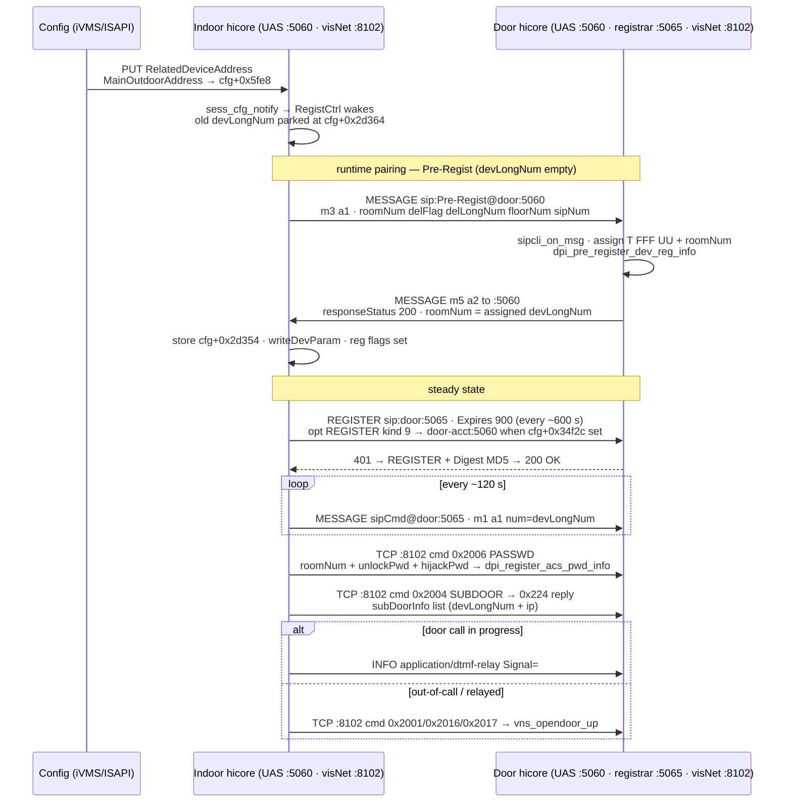

# Doorbell pairing & door↔indoor signaling — firmware internals

How `hicore` (Metzler VTH 2.0.24, rebranded Hikvision indoor station) pairs
with an outdoor **door station**: who registers where, the "Pre-Regist"
number-assignment exchange, unlock credentials, keepalives, and the visNet
TCP :8102 channel. Extension-facing registrar details:
[`intercom-registration.md`](intercom-registration.md); wire dialect:
[`../protocol.md`](../protocol.md). Sources: `readable/sip/{client/
registration.c,xml_proc.c}`, `readable/misc/net_sipClient_{sip_client,
visNetServer}.c.c`, `readable/visnet/visnet_server.c`,
`readable/misc/dataManagement_database_db_api.c.c`,
`readable/isapi/videointercom{,_do}.c`.

## 1. Pairing model — who registers with whom

The system is a tree; every "inner device" has one configured **parent**
whose IP lives at `cfg+0x5fe8` (the "regist ip" block):

| Device | Parent (`cfg+0x5fe8`) | Registers to | visNet target |
|---|---|---|---|
| door station (outdoor) | — (root) | — | indoors (accepts) |
| main indoor (room master) | **main door** | door `:5065` (kind-1) / door SIP acct `:5060` (kind-9) | door `:8102` |
| indoor extension | **main indoor** | main indoor `:5065` | main indoor `:8102` |

Every station runs the same code (`task_sipServer` :5065, eXosip UAS :5060,
visNet server :8102); roles come from cfg flags (`srv_isIndoor_w`,
`netAltRoute`, `netDualNic`, `cfgFlagC/F/H/J`). Two link mechanisms
coexist:

- **Config-time pairing** — ISAPI/iVMS writes the topology into cfg (§2);
  a statically numbered device then only does plain REGISTER (`ANALYSIS.md`
  §4: pre-registration "only needed if the door station requires it").
- **Runtime pre-registration** — a device whose own `devLongNum`
  (`cfg+0x2d354`) is **empty** sends a `Pre-Regist` SIP MESSAGE to the
  parent and *receives its number* in the reply (§3).

## 2. Config-time pairing (iVMS / ISAPI)

`PUT RelatedDeviceAddress` (`isapiIntercomRelatedDeviceAddrBasic`
@0x001ce5c8 → `isapiApplyVisRelatedDevice` @0x001d6fc8,
`isapi/videointercom{,_do}.c`) carries the topology: `<MainRoomAddress>` ·
`<MainOutdoorAddress>` (the door) · `<ManageAddress>` · `<SIPServerAddress>`
· `<CenterAddress>` · `<AgainAddress>` (secondary door) ·
`<MainOutdoorType>` (`mainOutdoor`→1 / `mainVilla`→2 → `cfg+0x6018`) ·
`doorRoomNetBuildMode` · `centerPort`. `sdkSaveVideoIntercomRelateDevCfg`
applies it → `sess_cfg_notify()` posts registration-change msgs to
`task_sipClient_RegistCtrl`, which drops the eXosip rids and — when
`cfgFlagF()!=0` and the old `devLongNum` is 11 digits — **parks it at
`cfg+0x2d364`** (`param_commit_lock()`) and clears `cfg+0x2d354`, priming
the next Pre-Regist to delete the stale binding. Factory door-block defaults
(`util_common_visUtil.c.c` ~0xf93e8): `cfg+0x350ce=60` (expire min),
`cfg+0x35040=0x13c4` (5060), `cfg+0x5fe8=192.0.0.65` only when `cfgFlagF()!=0`.

## 3. Runtime pre-registration — "Pre-Regist"

### 3.1 Trigger (client side — `task_sipClient_RegistCtrl` 0xe0dc4, `sipcli_voip_reg_task` 0xe1a04)

- `reg_guard_check()` @0x000db610: `netAltRoute()!=0` **and** `cfg+0x5fe8`
  set **and** `FUN_000f7ef8(cfg+0x2d330)==1` (dev num resolvable); on
  non-type-2 systems also `u16@cfg+0x2d336 < 1000`.
- own `devLongNum` slot empty (guard fields `DAT_000e19d4`/`0xe230c`, inferred
  `cfg+0x2d354` — reply store and failure `memset(cfg+0x2d354)` both target
  it) → `sipcli_send_msg(&blk,"Pre-Regist",flag)`: `flag=1` in `voip_reg_task`
  (adds `<sipNum>`), `−1` in `RegistCtrl`. Failure → `"Inner device
  pre-register to door failed!"` → retried.

### 3.2 The MESSAGE on the wire

`sipcli_send_msg` (@0x000dc9b0) builds `MESSAGE sip:Pre-Regist@<parent-ip>:5060`
(method 3 → `0x13c4`, the UAS — **not** the registrar), `From:
sip:%05d@<localip>` (`%05d` room number), `Content-Type: text/xml`, body
from `_sip_xml_get_sip_info_xml` (@0x000ea910):

```xml
<videoIntercomMsg><header><method>3</method><action>1</action>
<from><deviceSN>…</deviceSN><ipAddr>10.0.0.x</ipAddr></from>
<to><ipAddr><parent-ip></ipAddr></to></header>
<body><roomNum>00101</roomNum><delFlag>1</delFlag>
<delLongNum>10010100000</delLongNum><floorNum>3</floorNum>
[<sipNum>…</sipNum>]</body></videoIntercomMsg>
```

| Field | Source | Meaning |
|---|---|---|
| `deviceSN`, `from/ipAddr`, `to/ipAddr` | serial, own ip, `cfg+0x5fe8` | requester identity → parent/door |
| `roomNum` (+0x38) | `%05d` of `u32@cfg+DAT_000e19e4` | requested room number |
| `delFlag` (+0x40) | 1 iff `strlen(cfg+0x2d364)==0xb` | "delete my old binding" |
| `delLongNum` (+0x44) | `cfg+0x2d364` (previous devLongNum) | stale row to remove; builder emits `'12345678910'` placeholder when send flag ≠ 1 |
| `floorNum` (+0x54) / `sipNum` (+0x58) | `u32@cfg+0x2d330/100` else `u16@cfg+0x2d336` / `cfg+0x34fcc`, indoor && flag==1 only | floor / door-account number |

### 3.3 Parent side — assign & reply (`sipcli_on_msg` @0x000ddbc8, m3 a1)

1. Gates `cfgFlagC()==0 && cfgFlagJ()==0` and `cfgFlagH()==0` (cfg meanings
   unresolved); own `devLongNum` must be 11 chars else `0x191`.
2. Assigned call_num = `own type-digit + own floor + own unit + roomNum`
   (`T FFF UU` + string) — the parent prefixes the child's number.
3. `dpi_pre_register_dev_reg_info` (@0x000fc24c): `where call_num='<assigned>'`
   absent → delete `where call_num='<delLongNum>'` (when `delFlag`), insert
   0xb0 dev_reg row `{call_num=assigned, dev_ip=requester, reg_time=now,
   dev_type=3}` into `vis.bin` table 10. Present (ret 4) → serial ==
   requester `deviceSN` → `200` (idempotent re-pair); different device →
   `0x192`; other errors → `400`.
4. Reply = a **separate** `MESSAGE` (not a 200 body), method 5 action 2,
   from/to swapped + parent's `deviceSN`, to the requester address taken
   from the request event, port 5060: `<body><responseStatus>200|400|401|402
   </responseStatus><roomNum><assigned devLongNum></roomNum></body>` —
   skipped when `srv_isIndoor_w()==1` (indoors don't serve Pre-Regist).

### 3.4 Child side — reply handling (same function, m5 a2)

`responseStatus==200` → clear `cfg+0x2d364`/`cfg+0x2d354`, copy reply
`roomNum` into `cfg+0x2d354` (now own devLongNum), `writeDevParam()`
persists, flags `*DAT_000de554=0`/`*DAT_000de558=1`, mq post. `0x191` →
registered flag cleared; `0x192` → "number in use" (`=1`, `&0xfffe`).

## 4. devLongNum construction & the type-1 door class

`devLongNum` = 11 digits `T FFF UU RRR II`, classified by `srv_splitDevNum`
/`devTypeFromNum` (`FUN_000f9418`/`FUN_000f9ce0`, `registrar.c` header):

| `call_num` shape | class | meaning |
|---|---|---|
| `unit!=0 && room==0` | **1 — DOOR** (5 when `cfg@0x6018==2`, villa) | outdoor door stations, e.g. live `10010100000` |
| `unit!=0 && room!=0` | 3 — ROOM | indoors; pre-regist rows inserted as dev_type 3 |
| `1000000000N` | 3 — ROOM | extension long-nums (`…0` = main) |
| `againdevice` / `ManageCenter` | 6 / 2 | secondary door / manage center |

The door class feeds `a=doorType:` on calls and the door-call `From:` (`protocol.md` §5, `intercom-registration.md` §10 — not duplicated here).

## 5. Credentials — `unlockPwd` / `hijackPasswd`

| Mechanism | Direction | Where | Notes |
|---|---|---|---|
| visNet cmd `0x2006` (PASSWD) | indoor → door `:8102` | `sipcli_set_pwd_w` @0x000dff50 → `visNetClientPasswd` @0x000dff04 | payload `{roomNum 0x14, unlockPwd 0x10, hijackPwd 0x10}` = `"%d%s"` of room-num + `cfg+0x2d3a4`/`cfg+0x2d3c4`; door stores via `dpi_register_acs_pwd_info` keyed by `room_num` |
| SIP `videoIntercomMsg` method 2 action 1 | (door consumes — *inferred*) | `_sip_xml_get_sip_info_xml` builder | `<roomNum><unlockPasswd><hijackPasswd>` — SIP-side equivalent; **no sender site found in this binary** |
| visNet cmd `0x2017` (AGAIN_UNLOCK) | peer → door | server dispatch ~0xf3a20 | password-checked unlock: payload compared against stored `cfg+0x7c0[0x20]` + `cfg+0x7e0[0x10]` → `vns_opendoor_up` → reply 4\|5 |

`unlockPwd` = the room's door-unlock password (validated at the door);
`hijackPasswd` = the duress variant (same unlock + silent alarm — inferred
from naming, not a hicore code path). The push is **main-indoor only**:
`sipcli_set_pwd_w` fails `"FALSE == isRoomMain"` when `netAltRoute()==0`,
driven by `task_sipClient_PasswdProc` (@0x000e2348) on mq `PROC_BOTH_PWD`.
In-call unlock is separate: `INFO application/dtmf-relay Signal=# /
Duration=160` on the door dialog (`sipcli_unlock_dtmf` @0x000df6c0);
out-of-call falls back to visNet `0x2001`.

## 6. Ongoing door↔indoor signaling

| Traffic | Destination | Period / trigger |
|---|---|---|
| REGISTER kind 1 | `sip:<parent>:5065`, Expires 900 | every >601 s + reg-change mq (`RegistCtrl`/`voip_reg_task`) |
| REGISTER kind 9 | `sip:<cfg+0x34f2c>:<cfg+0x35040>` (dflt 5060), Expires `cfg+0x350ce`×60 | every `cfg+0x350ce`×45 s (120 s initially); only when the door-account block (`+0x34fac` phoneNo, `+0x34fcc` authName, `+0x35000` server) is configured && `!netDualNic` |
| Heartbeat m1a1 `<num>` | `sip:sipCmd@<registrar>:5065` | ~120 s, skipped in call (`task_sipClient_HeartBeat`) |
| Alarm/zone m6 `<ID><devType><alarmTime><zone*>` | `sip:<cfg+0x350cf>@<cfg+0x35000>:5065` (door registrar, AOR = main num) | per event (`sendInfoType6` @0x000e0198) |
| visNet cmds (§8) | `:8102` | on demand |

## 7. Main vs extension

- `reg_guard_check` requires `netAltRoute()!=0` (the "isRoomMain"-style
  flag) → **Pre-Regist is a main-device path** in this binary; extension
  indoors only kind-1/kind-8 REGISTER to the main indoor.
- Only the main indoor pushes unlock/hijack passwords (§5) and pulls the
  sub-door list (§9).
- The main indoor also *plays* parent for extensions: same `sipcli_on_msg`
  m3 handler + :5065 registrar + :8102 visNet server (`0x2018` ext-record
  ingest, `0x2033` reg-table push after each extension REGISTER —
  `intercom-registration.md` §8). Its `cfgTalkbackFlag` loop variant
  (`sipcli_voip_reg_task`) sends Pre-Regist with `flag=1` (`+<sipNum>`).

## 8. visNet channel — TCP :8102

Optional proprietary channel, separate from SIP
(`readable/visnet/visnet_server.c`). **Direction:** whichever side needs
something connects to the peer's `:8102` — indoor→door for
unlock/subdoor/passwd, door/main→extension for table push/relay. Server
`taskVisNetServ` @0x000f4d80 → per-conn `taskVisClientReq` @0x000f2a28.

**Auth (verified):** on accept the server sends fixed 200-byte serverInfo
(`+0x08` = nonce[0x40] = hex-MD5 of `"Vis:Hikvision:<asctime>"`). Every cmd =
0xac header + payload: `+0x00 u32be len · +0x08 u32be netCmd · +0x0c keySeed
· +0x14 clientNum[0x10] (own devLongNum) · +0x24 longNum[6] · +0x2c nonce
echo · +0x6c signature[0x40] · +0xac payload`. `visNetServerDeserializeCmd`
@0x000f1b08 rejects nonce/signature mismatch ("Illegal nonce package" /
"Illegal signature package"); the signature is **hex-MD5 over the frame
with sig field zeroed** (integrity, not a keyed MAC); payload XOR'd with
`0x5577aabb ^` fold(nonce). Replies `{u32be len, u32be code,…}`; 1 = ok.

Door-relevant commands (verified wire values):

| netCmd | Name | Function / payload |
|---|---|---|
| `0x2001` | UNLOCK | `vns_clientUnlock` @0x000eec04, 0xb4 pkt `+0xa8 lockId`; reply 1 = "Open door success!" |
| `0x2004` | SUBDOOR | `vns_subdoorReq` @0x000efc28 → reply 0x224 `{ret,num,rec[]}` → `sess_door_tbl_fill` |
| `0x2006` | PASSWD | `visNetClientPasswd` @0x000dff04, 0xec pkt `{room,unlockPwd,hijackPwd}` → `dpi_register_acs_pwd_info` |
| `0x2016`/`0x2017` | EX_UNLOCK / AGAIN_UNLOCK | `opType` 0 → `sipcli_unlock_dtmf` (local SIP-DTMF); 1 → `vns_clientUnlock` relay · password check vs `cfg+0x7c0/0x7e0` → `vns_opendoor_up` |
| `0x2018` | ALARM / ext-record push | `vns_registerExtRec` → server `db_notify_insert` / `gui_win_manage`+`sendInfoType6` |
| `0x2022` | OPEN_VISTALK | talk long-connect → QUALIFIED → hb loop; server pulls caller's `:554`; busy → "The device is busy!!!" |
| `0x2002`/`0x2020`/`0x2019` | LADDER / SUBLADDER / EX_LADDER | `visNetServLadder` @0x00011198 — main-door only |
| `0x2009`/`0x2014`/`0x2010` · `0x8001` | EX_DOOR / EX_AGAIN / EX_IPC queries · `vns_queryPorts` | replies 0x264 (≤8/≤10 recs) · 0x2420 (≤16×0x240) · 0x48 (7×u16be ports) |
| `0x2033`/`0x2032` | EX_ROOM_INFO_SYNC / EX_ROOM | registrar → ext `:8102`, 0x420 pkt `{count, ≤6×0xb0 dev_reg}` after each ext REGISTER · pull: ext → `cfg+0x6034`, reply 0x390 into `g_extRoom` |
| LVMSG `0x2003` · ANSWER `0x2005` · UASTALKSTART `0x2011` · SET_ROUTE `0x2015` · CALL_APP `0x2024` · GET_LOCK_NO `0x2025` · SET_QR | misc | `visnet_server.c` dispatch table |

## 9. Sub-door support

"Sub-doors" = secondary outdoor units under the main door, enumerated
**without SIP**: `vns_subdoorReq(0)` → cmd `0x2004` to `cfg+0x5fe8:8102`
(main door), `vns_subdoorReq(1)` → `cfg+0x601c` (again door); the 0x224
reply `{num, 0x40-records {devLongNum, subDoorIp}}` → `sess_door_tbl_fill`/
`sess_again_tbl_fill` ("room get subdoor info from maindoor."). Server side
`visNetServSubdoor` builds the list via `sipcli_dev_search`. On failure
(non-indoor) → `"set ezviz maindoor zero"` + local fallback `sipcli_door_reg`
(@0x000e2d1c) fabricating rows `"main:%d-%d-%d"`/`"sub:%d-%d-%d-%d"` with
ip=`cfg+0x5fe8`, **port 0x22a (554 — door RTSP)**, user `admin` — the table
driving door-camera pulls and unlock targets. The SIP-side mirror is
`videoIntercomMsg` method 5 action 7: `<subDoorInfo>` × ≤8 of `<devLongNum>`
+`<subDoorIp>` (*inferred* door→indoor subdoor-list response — no sender
site in this binary). Dual-NIC mode uses `vns_doorReq` against `cfg+0x6034`
(`visNetClientdoor`, `g_mainDoor` @0x00778660).

## 10. Sequence

<!-- mermaid: fw-doorbell-pairing -->


## 11. Key functions

| Function | Address | File | Role |
|---|---|---|---|
| `task_sipClient_RegistCtrl` | 0x000e0dc4 | `sip/client/registration.c` (+raw ~0xe1440) | register loop; Pre-Regist flag=−1 branch; gated by `reg_guard_check` @0x000db610 |
| `sipcli_voip_reg_task` / `eXosip_client_voip_regist_task` | 0x000e1a04 | same (+raw ~0xe230c) | cfgTalkbackFlag variant; Pre-Regist flag=1 (+sipNum); kind-9 door REGISTER |
| `_client_handle_register` / `sipcli_register` | 0x000e05e0 | `sip/client/registration.c` | REGISTER builder; kind 9 = door block `cfg+0x34f2c` (port `+0x35040`, exp `+0x350ce`×60) |
| `sipcli_send_msg` | 0x000dc9b0 | `misc/net_sipClient_sip_client.c.c` | MESSAGE sender; `sip:<AOR>@<toIp>:<port>` — 5065 for methods 1/6 else 5060 |
| `_sip_xml_get_sip_info_xml` / `_sip_xml_pares` | 0x000ea910 / 0x000eb5ec | `sip/xml_proc.c` | videoIntercomMsg builder / parser (0x138 struct) |
| `sipcli_on_msg` / `_client_handle_message` | 0x000ddbc8 | `misc/net_sipClient_sip_client.c.c` | inbound MESSAGE: m3a1 → assign+reply · m5a2 → store devLongNum |
| `dpi_pre_register_dev_reg_info` | 0x000fc24c | `misc/dataManagement_database_db_api.c.c` | pre-regist dev_reg dedup/insert; del `where call_num=<delLongNum>` |
| `task_sipClient_PasswdProc` → `sipcli_set_pwd_w` / `sipcli_set_passwd` | 0x000e2348 / 0x000dff50 / 0x000dff04 | same | `/passedProcMsg` mq → main-only unlockPwd+hijackPwd → visNet `0x2006` to door `cfg+0x5fe8` |
| `sipcli_unlock_dtmf` / `sendInfoType6` | 0x000df6c0 / 0x000e0198 | `sip/client/call_out.c` / `misc/net_sipClient_sip_client.c.c` | in-call INFO `Signal=#` unlock (else visNet `0x2001`) · method-6 alarm/zone MESSAGE → `sip:<mainnum>@<cfg+0x35000>:5065` |
| `sipcli_call_door` / `sipcli_door_reg` | 0x000e2fb0 / 0x000e2d1c | same | door enumeration driver / local door-table fallback (port 554, admin) |
| `visConnectServ` | 0x000ee49c | `visnet/visnet_server.c` | TCP :8102 connect (SO_BINDTODEVICE) + read 200-B serverInfo |
| `visNetClientSerializeCmd` / `visNetServerDeserializeCmd` | 0x000ee850 / 0x000f1b08 | same | build/verify signed cmd (nonce echo + MD5 sig + XOR payload) |
| `taskVisNetServ` / `taskVisClientReq` | 0x000f4d80 / 0x000f2a28 | same | :8102 listener → per-conn netCmd dispatch |
| `vns_clientUnlock` / `vns_subdoorReq` / `vns_doorReq` / `vns_exUnlock` | 0x000eec04 / 0x000efc28 / 0x000eff9c / 0x000f0504 | `misc/net_sipClient_visNetServer.c.c` | 0x2001 unlock · 0x2004 subdoor pull · 0x2009/0x2014 door lists · 0x2016 relay |
| `vns_registerExtRec` / `vns_pushExtRoomByIp` | 0x000f12a4 / 0x000ee9dc | same | 0x2018 ext/alarm record · 0x2033 reg-table push (0x420 pkt) |
| `vns_cmd04Subdispatch` ("visNetServSubdoor") / `visNetServLadder` | 0x000f28a8 / 0x00011198 | `misc/net_sipClient_visNetServer.c.c` / `visnet/visnet_server.c` | server: subdoor list · main-door floor call |
| `isapiIntercomRelatedDeviceAddrBasic` / `isapiApplyVisRelatedDevice` | 0x001ce5c8 / 0x001d6fc8 | `isapi/videointercom{,_do}.c` | config-time pairing: RelatedDeviceAddress PUT → cfg + re-register |

## Gaps / unverified

- `DAT_000e19d4`/`0xe230c` assumed `cfg+0x2d354` (devLongNum); roomNum /
  floorNum / interval cfg fields (`DAT_000e19e4`, `DAT_000e2340`,
  `DAT_000e2338`) likewise inferred from usage.
- Senders of method-2 / method-3a3 / method-5a1/a4/a7 (password & subdoor
  payloads): vocabulary verified, sender sites live in door-side code not
  in this indoor binary (directions marked *inferred*).
- Exact `cfgFlagC/F/H/J` semantics; `visNetServSubdoor` reply magic
  (`0x1000000`/`0x2000000`) meaning; whether `0x2033` reg-table pushes
  reach indoors (push is `1000000000`-filtered → extension-style numbers).
