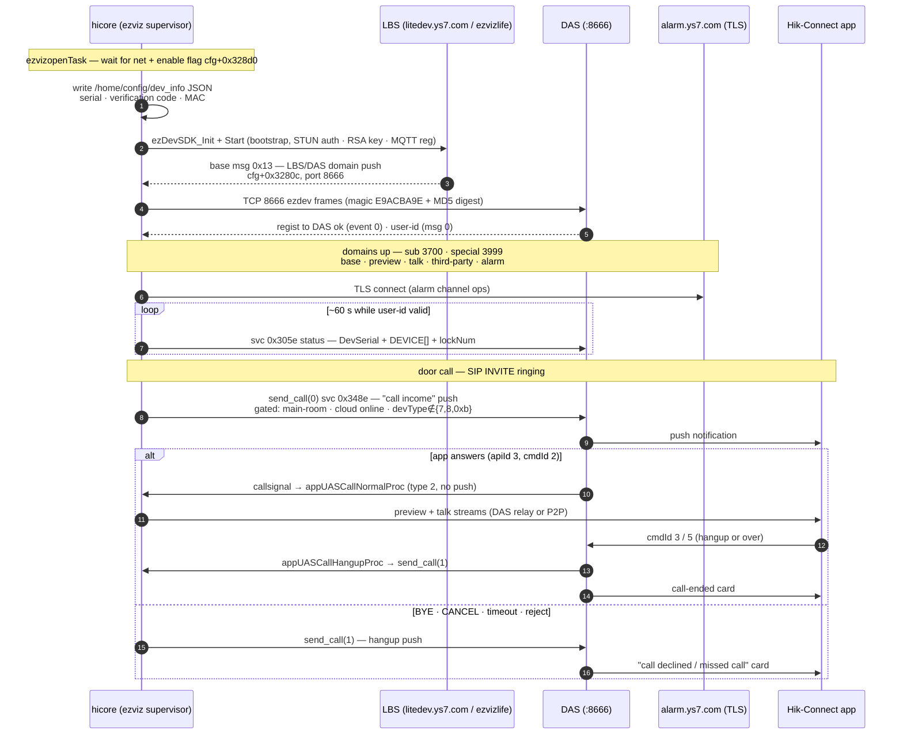

# Hik-Connect / EZVIZ cloud channel — registration and call-state pushes

How `hicore` (Metzler VTH 2.0.24, a rebranded Hikvision indoor station) talks to
the Hik-Connect / EZVIZ cloud. Evidence: `vdm10_1.0/ezviz/*.c` (app layer,
`protocol/ezviz_*.cpp`), `vdm10_1.0/ezdevsdk/*.c` (SDK subcore), and
`vdm10_1.0/misc/dclog.c` (SDK transport internals). The SDK kernel itself is
largely external (`/* ext */` markers) — internals cited here are recovered
from call sites, log strings and the few decompiled subcore files.

## 1. ezDevSDK and the layered architecture

| Layer | Code | Role |
|---|---|---|
| App | `protocol/ezviz_*.cpp`, `route/ezvizRoute.c`, `transProtocol/ezviz_trans_parse.cpp`, `functions/ezviz_send_stream.cpp` | registers per-domain callbacks, builds JSON/records, drives local SIP on app commands |
| ezDevSDK subcore | statically linked, `subcore/*` + `userpace/src/domain/*` (jenkins tree `Frontend.Civil.All-SDK`, `trans_parse2.c` header) | framed+digested channel to DAS, LBS/DAS bootstrap, MQTT transport, P2P/UDT NAT traversal, per-domain streams |
| Cloud | LBS → DAS (`<dasDomain>:8666`) → per-domain channels + TLS alarm link | push delivery, call signaling, alarm store, OTA, remote view |

ezDevSDK is Hikvision's embedded cloud SDK: the device never speaks HTTP or
push-protocol directly to Hik-Connect — it opens one framed channel to a
**DAS** (device access server) reached through an **LBS** bootstrap, then
multiplexes "domains" (base, preview, talk, third-party, alarm) plus
kernel-extend channels ("sub" :3700, "special" :3999) over it.

## 2. Service lifecycle — `control.c` (`protocol/ezviz_control.cpp`)

Supervisor thread `ezvizopenTask` @0x003d9fbc: waits for network
(`if_is_device_active`) **and** the EZVIZ enable flag `cfg+0x328d0` non-empty;
writes `/home/config/dev_info`; then runs `start_ezviz_service` @0x003d9dbc:

| # | function | addr | role |
|---|---|---|---|
| 1 | `ezviz_boot_start` | 0x003d9770 | `ezDevSDK_Init(dasDomain=cfg+0x3280c, port=*(u16*)(cfg+0x328cc), cbBlk, 1)` + `ezDevSDK_Start` (`FUN_0047c3c0`/`FUN_0047c70c`, ext); cb block carries event/log/kv-load/kv-save/dev_id/masterkey getters and the paths `/home/config/{dev_info,dev_id,dev_masterkey}` |
| 2 | `start_sub_domain` | 0x003d9c14 | kernel-extend domain `"sub"` v1.0.0, **port 3700** |
| 3 | `start_special_domain` | 0x003d9ce8 | kernel-extend domain `"special"`, **port 3999** |
| 4 | `ezviz_register_domain` | 0x003db638 | **base** domain: recv cb `ezviz_base_cb_recv_ezviz_msg`, maxmsg 0x20000 |
| 5 | `ezviz_preview_domain_start` | 0x003e02d0 | live A/V to the app (`av.c`) |
| 6 | `ezviz_talk_op_register` | 0x003de2e4 | two-way voice (`audio.c`) |
| 7 | `ezviz_thirdparty_domain_start` | 0x003e2e0c | JSON app↔device + call pushes (`third_party.c`) |
| 8 | `ezviz_alarm_domain_start` | 0x003dcf94 | TLS alarm channel, 11 type-indexed staging bufs (`alarm.c`) |

`stop_ezviz_service` @0x003d992c tears down in the same order (any failure
aborts). The supervisor's 2 s loop restarts everything when: the enable flag
clears, `cfg+0x3280c` changes (`"##### LBS changed ....."`, the DAS push), or
the interface flips wlan0↔eth0 (`FUN_00482014(1, ifname, 5)`).

## 3. Bootstrap: LBS → DAS → session

Verified against `base_function.c`, `control.c`, `misc/dclog.c`:

1. `ezDevSDK_Init` gets the LBS domain (`cfg+0x3280c`) + port
   (`cfg+0x328cc`, default **8666** = 0x21da). paramLib defaults write
   `litedev.ys7.com` (dev-mode==2) else `litedev.ezvizlife.com`, alarm server
   `alarm.ys7.com` at `cfg+0x3284c`, ports 8666/7400
   (`system_param_paramLib.c.c` @0x00068618).
2. SDK-internal bootstrap (names recovered in `dclog.c`, not decompiled):
   STUN auth (`stun_send_refreshkey_i/iii`, `parse_auth_ii`), RSA session-key
   encryption (`RSA(010001)` = exp 65537), `createdevid_iii`,
   reg/light-reg/unreg — then **MQTT** ("MQIsdp", Aliyun-style
   `productKey/deviceName/deviceLicense`) publishing devinfo to
   `/Basic/pu2cenplt/%s/devinfo`. SDKVersion string `V2.0.6`.
3. SDK→app base-domain msgs (`ezviz_base_cb_recv_ezviz_msg` @0x003db1d8):

   | type | payload | handler |
   |---|---|---|
   | 0 | user-id string | `g_userId` @0x0076a246 — the cloud-assigned device user id; `ezviz_user_id_valid()` = non-empty and ≠ `"0000000000000000"` |
   | 1 | — | `"start upgrade"` (puts only) |
   | 2 | `{u32 num; pkt[0x354]}` | OTA packet info → `ezviz_ext_cb_upgrade_packet_info` |
   | 0x13 | 0x40-byte domain | LBS/DAS push → `cfg+0x3280c`, port 8666; supervisor restarts on change |
   | 0x14 | `{u32 x; str proto; str content; u32}` | HCNetSDK-over-EZVIZ request → `ezviz_net_client_sdk_proc` |

4. `event_notice_callback` @0x003d9294: case 0 `"Device regist to DAS"` →
   `g_registered`=1; 1 offline; 2 re-regist after LBS/DAS switch; 3 invalid
   authcode; 4 fast re-regist.
5. Once `sipcli_fae8c && ezviz_user_id_valid` hold, the supervisor fires the
   ~60 s keepalive `ezviz_net_Pu2client_proc` @0x003e773c (svc **0x305e**:
   `{DevSerial, DEVICE[]{Enable T/F,Type:S,Index,NickName,Serial},
   Status{Type:"lockNum",Value:{json}}}`) and refreshes the third-party token
   (`ezviz_third_party_token_req`, svc 0x348c, `{AppKey, "sdk", "signal"}`;
   stale when >0x93a80 ≈ 7 days).

## 4. Wire frame (verified — `ezdevsdk/ezdev_basic.c`)

Every device↔DAS message (default TCP **8666**) is built by `ezdev_send`
@0x00437928 and parsed by `ezdev_recv` @0x00437b40:

| offset | field | encoding |
|---|---|---|
| 0x00 | magic `E9 AC BA 9E` | stored LE `0xe9acba9e`; receiver bswaps → `0x9ebaace9` |
| 0x04 | version = 1 | native-LE |
| 0x08 | seq | **BE**, global `g_ezdev_seq` @0x009b6ba8, ++/msg |
| 0x0c | code | **BE** service/domain code |
| 0x10 | subcode | **BE** msg type — the `ezdev_recv` return value |
| 0x14 | flags | 0 (always, this build) |
| 0x18 | body_len | **BE** = name_len + payload_len |
| 0x1c | name_len | **BE** strlen(name); 0 when no binary payload |
| 0x20 | name + payload | body (name has no NUL) |
| +body | digest | 32 bytes over the **body only** — recv log calls it "md5 digest" (MD5→32 hex chars, possibly keyed; `md5_hash`/`FUN_004464e0` not recovered) |

Total = `0x20 + body_len + 0x20`. Header is **not** covered by the digest.
Unverified: whether the digest is keyed, and whether the payload is
additionally encrypted — the subcore also contains AES-CBC
(`ezd_aes_enc`/`ezd_aes_dec`) and the RSA STUN key exchange, so per-session
crypto may exist above this layer (`platform_encrypt.c` path strings).
Earlier notes describing this trailer as a generic "encryption wrap" are
superseded by the digest analysis in `ezdevsdk/README.md`.

Service codes observed: `0x3038`→3700, `0x305e`→3999 (keepalive),
`0x3482`→3999, `0x348c` third-party token req, `0x348e` call push,
`0x4904`→1100, `0x4950` MsgSeq data, `0x6001` rejected
(`ezviz_base_send_ezviz_msg` @0x003dafc0).

## 5. Device registration / activation

| Piece | Where | Detail |
|---|---|---|
| `dev_info` file | `ezviz_save_device_info` @0x003d9ab0 | JSON → `/home/config/dev_info`: `dev_status`, `dev_subserial`, **`dev_verification_code`**, `dev_serial`, `dev_firmwareversion`, `dev_type`, `dev_mac`, `dev_nickname`, `dev_firmwareidentificationcode`, `dev_oeminfo` |
| Persistent creds | `ezviz_boot_start` cb block | paths `/home/config/dev_id`, `/home/config/dev_masterkey` handed to the SDK (bound-account key material lives here, app code never touches it) |
| DevSerial | `FUN_004821f4("dev_subserial")` | sent as `DevSerial` field in every third-party-domain message |
| user-id | base msg type 0 | cloud-assigned `g_userId` — presence ⇒ registered+online, gates keepalive and the call push |
| appKey | `cfg+0x3288c` | 32-hex OEM appKey compiled into paramLib defaults (@0x00068618); used for token requests and call pushes |
| token | `third_party.c` | 0x348c req `{Authorization:"", DevSerial, AppKey, Destination:"sdk", Auth:"signal"}`; reply type 0 → `g_token`; `SIGN_CHECK_ERR` response invalidates it |
| QR binding | `gui_civilset_QRstr_Get` (`src_gui_civilset.c.c` ~line 870) | QR payload starts with `www.hik-connect.com` and embeds the cfg+0x328d0 area/operator code — the phone-app pairing string; verified it exists, full layout not decoded |
| operation code | `ezviz_set_operation_code` @0x003d9690 | forwards `cfg+0x328d0+2` (skips a 2-byte prefix) to `ezd_sdk_init_ok` — the same field that enables the service and feeds the QR string |

## 6. Servers / domains contacted

| Host | Source | Role |
|---|---|---|
| `litedev.ys7.com` / `litedev.ezvizlife.com` | paramLib default `cfg+0x3280c` | default LBS (picked by dev-mode) |
| `dev.ys7.com` | `setEzvizServer` serial cmd @0x00059974 | production env override |
| `test/test2/test5.ys7.com`, `t2dev.ezvizlife.com`, `pbopen.ys7.com`, `ifuxi.ezvizlife.com`, `dev.ezvizlife.com` | same cmd | test/staging envs, all port 8666 |
| `alarm.ys7.com` | paramLib default `cfg+0x3284c` | alarm-domain TLS server |
| `www.hik-connect.com` | `gui_civilset_QRstr_Get` | QR/binding URL host (displayed, not dialed) |
| `www.hik-online.com` | paramLib default (+0x586c) | alternate web host, selected by `FUN_00075040` (region check /* unverified */) |
| `devlog.ys7.com` | string table (HIKCONNECT.md) | telemetry host — unverified in `vdm10_1.0/`; dclog uploads go out as `multipart/form-data` HTTP (`dclog_upload_ezdev` @0x004257fc) |

## 7. Call-state pushes — what produces the Hik-Connect cards

Three distinct mechanisms; only the first is the SIP-driven push:

**(a) Third-party-domain call push (the user-facing cards).**
`ezviz_third_party_send_call(callState)` @0x003de520 sends svc **0x348e**
("pu2opentransferdata") with fields `Authorization=""`, `DevSerial`,
`Token`, `MsgSeq`=uuid, `AppKey` (cfg+0x3288c), `Destination`, `Type`,
`Data` = `{"push_setting":{"alert":"<utf8 GBK name>"}}` plus a sound tag
`com.hikvision.4530.ring:{0|1|2}`. Alert names (`callAlertTable` @0x006d8a40):
0 "call income" (收到一条呼叫), 1 "hangup" (收到一条挂断), 2 "answer" —
**only 0 and 1 are ever sent** by the call path. A 0→1 sequence with no app
answer renders as the "call declined / missed call" card.

| Trigger | Caller site | Action |
|---|---|---|
| INVITE ringing | `ezviz_NewCallProc` @0x003de838, sole caller sip_client ring loop @0x000dc5dc | `send_call(0)` then `g_ezvizCallState` @0x0081b10c = 1 |
| call ends: BYE / CANCEL / timeout / local hangup / answer-reject | `call_cloudHangPost` = `ezviz_CancelCallProc` @0x003de9ac — 6 SIP teardown sites @0xe5f18/0xe65f4/0xe807c/0xe817c/0xea2a8/0xea620, all `(0,1,handler)` | `send_call(1)` then state → 0 |
| app answers (cmdId 2) | `appUASCallNormalProc` @0x003e478c → `(0,2,arg)` | type 2 = no cloud push (returns early when state∈1..3); local accept path runs |
| app refuses/hangs (cmdId 3) | `appUASCallHangupProc` @0x003e4994 → `(0,1,arg)` | hangup push as above |

Gating (all required for the ring push — `audio.c` + caller table):

- `netAltRoute()`/`srv_isMainRoom` (FUN_000f86b0) — **main-room device only**;
- cloud bound: `ezviz_user_id_valid()` and `ez_dev_mode_get()`==2
  (FUN_000549d8; ==2 selects the direct push path, else the mq/alarm path —
  the mode semantics are marked unverified in `names/ezviz.tsv`);
- ring-delay byte elapsed (per-session cfg byte, exact source unverified);
- caller devType class (`sess+0x7c` via `devTypeFromNum`) **not in {7,8,0xb}**
  — sub-door index classes / indoor-only modes are suppressed; main door
  1/5, door 2, generic 3/4/6/9 are pushed;
- caller number ≠ `"1000000000"` (the room base = self).

**(b) Alarm-domain call record (call log + JPEG).** When `ez_dev_mode_get()!=2`
the same events are queued as 0x48-byte `{type,channel,handler[0x40]}` msgs on
`/ezviz_talk_message` (`g_ezvizCallMq`); `ezviz_talk_task` @0x003ded74 replays
them: type 0 → `ezviz_ext_start_talk` → `ezviz_ext_push_alarm_call_hangup(0)`
@0x003dc87c builds a 0x14c record `{ver 2, channel, time, alarmType 1,
caller "N-N-N-N", handler, callUuid "<ts>-<devno>-1-00000-<rand>", callType 4}`
with a JPEG snapshot (`ezviz_decapture`), types 1/2 → hangup record
(alarmType 3/2). Sent via the TLS alarm channel.

**(c) Poll replies.** Third-party `apiId 1` getcallstate and HCNetSDK cmd
`0x126020` report `tp_get_call_state`-1 (0 idle / 1 calling / 2 talking; the
app-session states 4/5 collapse to byte 1 "Error-ish" — no push is generated
for them). `apiId 3` callsignal cmdId 2/3/4/5/6 = answer / refuse / ringover /
over / busy → the `appUASCall*Proc` handlers above (rc 1 or 0x7a0–0x7a7).

## 8. Other cloud traffic

| Traffic | Path | Detail |
|---|---|---|
| Keepalive/status | svc 0x305e, ~60 s | DevSerial + door table + lockNum JSON (`ezviz_net_Pu2client_proc`) |
| Sensor/defend alarms | alarm TLS | `ezviz_ext_push_alarm_nol` @0x00108644 — 0x43-entry type table @0x0076a288; defend-internal ranges {5–10,12–14,16–29} refused |
| Smart-lock events | alarm TLS | `ezviz_ext_push_alarm_trans` @0x003dc4f8 — types 0x11–0x16, 0x65–0x98; `<SmartlockSN>`/`<SmartLockName>`/`<openType>` tags base64'd |
| Remote view / talk | preview + talk domains, or P2P/UDT | preview cb cmds start/stop/param/iframe (`ezviz_preview_recv_msg_cb`); EzvizStreamBuf 4×0x80000 rings keyed by source IP; uplink frame `{3,2,len,seq,0x55667788}` + 0xa0 frames (`send_stream.c`); P2P v3 + UDT NAT traversal in subcore (`dclog.c` map) |
| Remote unlock | third-party apiId 2 / HCNetSDK 0x126009 | `ezviz_third_party_remotecontrolgateway` → `sipcli_gateway_unlock(srcId, channel-1, lockId)`; smart-lock variant checks the DB password → rc 0x7a3–0x7a7 |
| HCNetSDK tunnel | base msg 0x14 → svc 5 reply | hex-ascii → `{len,cksum,netCmd}` binary → reply base64 in `{ProtocolType:"HCNetSDK",Content}` (`ezviz_net_client_sdk_proc` @0x003e7268); includes `/ISAPI` passthrough 0x117000–3 (GB28181Service write can reboot) |
| Cloud OTA | base msgs 1/2 + query | `ezviz_ext_cb_upgrade_packet_info` @0x003e3858 → `http://ip:port/file`, version compare → `ezvizUpgradeTask` retry downloader |
| Shadow property sync | SDK module 0x3ea | cmds 0x16/0x21/0x22/0x23/0x24 JSON `{BusiID,Type,Value}` (`ezdevsdk/shadow_func.c`) |
| Telemetry | dclog | `GenerateDCLog` @0x00441b5c JSON array; record tags 0x3e9 (stream/call stats) / 0x3ef (net online); separate HTTP file upload |
| Cloud storage ext | `cloud.c` | open/write/close are **log-only stubs** — feature compiled out in this build |

<!-- mermaid: fw-hikconnect -->

## 9. What the simulator does / doesn't need

The sim never speaks to the cloud — which is fine, because the push path lives
in the **main indoor's** firmware, not the callee's:

| Sim behavior | Cloud consequence |
|---|---|
| Local SIP plane only (`--sip-host` PBX / Linphone bridge) | none needed — the EZVIZ enable flag `cfg+0x328d0` can stay empty; supervisor then skips `start_ezviz_service` entirely |
| Door call rings a real main indoor | the main indoor itself pushes state 0→1; our sim only affects whether the call looks "answered" (200 OK → BYE = normal hangup) or "declined" (4xx/timeout → missed-call card) — exactly the cards described in `docs/protocol.md` §7 |
| Remote answer via Hik-Connect app | not reproducible: needs DAS + third-party domain + token; the app's `apiId 3` callsignal and HCNetSDK tunnel terminate in firmware code the sim doesn't run |
| Remote view / talkback from the app | not reproducible: preview/talk domains + P2P/UDT + EzvizStreamBuf machinery |
| Remote unlock from the app | sim-side equivalent is the SIP `INFO` DTMF / `locknumXML` path, not the cloud `apiId 2` |
| Missed-call cards for calls TO the sim | only if the sim registered its own cloud account — out of scope; implementing it would mean the 0xE9ACBA9E frame + digest + STUN/MQTT registration + domain channels |

## 10. Unverified / open items

- MD5 digest keying and any payload encryption above the frame layer
  (`platform_encrypt`, `md5_hash`/`FUN_004464e0` not decompiled).
- `ez_dev_mode_get` (FUN_000549d8) semantics beyond "==2 selects the push path".
- Exact STUN→MQTT registration sequence inside the SDK (names recovered only).
- `devlog.ys7.com` usage; alarm.ys7.com TLS details (ALPN, cert pinning — the
  ctx uses `SSLv23_client_method` + ctrl 0x21, verify mode unclear).
- Zigbee/third-party appKey derivation and token lifetime accounting.

## Key functions

| function | addr | file | role |
|---|---|---|---|
| `ezvizopenTask` | 0x003d9fbc | control.c | supervisor: net/enable wait, LBS-change + iface restart, 60 s keepalive, token refresh |
| `ezviz_boot_start` | 0x003d9770 | control.c | dev-info file + ezDevSDK_Init/Start |
| `start_ezviz_service` | 0x003d9dbc | control.c | ordered domain bring-up (boot → sub 3700 → special 3999 → base → preview → talk → third-party → alarm) |
| `event_notice_callback` | 0x003d9294 | control.c | SDK reg/offline/fast-regist events |
| `ezviz_base_cb_recv_ezviz_msg` | 0x003db1d8 | base_function.c | SDK→app pump: user-id (0), OTA (1/2), LBS push (0x13), trans req (0x14) |
| `ezviz_base_send_ezviz_msg` | 0x003dafc0 | base_function.c | svc-code → port map, kernel send |
| `ezviz_base_set_ezviz_server` | 0x003db148 | base_function.c | write pushed LBS/DAS domain to cfg+0x3280c |
| `ezdev_send` / `ezdev_recv` | 0x00437928 / 0x00437b40 | ezdevsdk/ezdev_basic.c | 32-byte frame + MD5 digest trailer, port 8666 |
| `ezviz_third_party_send_call` | 0x003de520 | audio.c | build+send svc 0x348e call push (states 0 call / 1 hangup / 2 answer-unused) |
| `ezviz_third_party_send_data` | 0x003e2b40 | third_party.c | "pu2opentransferdata" req fields + send |
| `ezviz_third_party_token_req` | 0x003e2948 | third_party.c | svc 0x348c token request (appkey/"sdk"/"signal") |
| `ezviz_thirdparty_recv_msg` | 0x003e2634 | third_party.c | domain inbound: token (0), app request (1), response (2) |
| `ezviz_third_party_callsignal` | 0x003e10d4 | third_party.c | apiId 3 dispatch → appUASCall*Proc |
| `ezviz_NewCallProc` | 0x003de838 | audio.c | ring → push(0) or mq record; main-room + dev-mode gates |
| `ezviz_CancelCallProc` (`call_cloudHangPost`) | 0x003de9ac | audio.c | hangup → push(1) when type==1 & state∈1..3; else mq record |
| `ezviz_talk_task` | 0x003ded74 | audio.c | `/ezviz_talk_message` mq → ext_start/stop_talk → alarm records |
| `ezviz_ext_push_alarm_call_hangup` | 0x003dc87c | alarm.c | 0x14c call record + JPEG over TLS alarm channel |
| `ezviz_ext_push_alarm_nol` / `_trans` | 0x00108644 / 0x003dc4f8 | alarm.c | sensor + smart-lock alarm pushes |
| `appUASCallNormalProc` | 0x003e478c | trans_parse.c | app answer (cmdId 2) — local accept + type-2 hangpost |
| `appUASCallHangupProc` | 0x003e4994 | trans_parse.c | app refuse/hangup (cmdId 3) — local hangup + push(1) |
| `tp_get_call_state` | 0x003e4730 | trans_parse.c | shared call-state getter (idle/door/app, calling/talking) |
| `ezviz_net_client_sdk_proc` | 0x003e7268 | trans_parse.c | HCNetSDK-over-EZVIZ request → reply pipeline |
| `ezviz_net_Pu2client_proc` | 0x003e773c | trans_parse.c | 60 s svc-0x305e status push |
| `netClientUAS2SDKProc` | 0x003e65c4 | trans_parse.c | netCmd dispatcher (unlock 0x126009, callstate 0x126020, callsignal 0x126022, ISAPI 0x117000–3) |
| `ezviz_ext_cb_upgrade_packet_info` | 0x003e3858 | upgrade.c | OTA packet-info → URL + version compare |
| `ezviz_preview_recv_msg_cb` | 0x003dff28 | av.c | preview domain cmds (start/stop/param/iframe) |
| `ezviz_ext_cb_on_start_talk` | 0x003dda30 | audio.c | talk-domain start → audio pump to SDK |
| `setEzvizServer` | 0x00059974 | misc/serial_shellCmd_toolserver.c.c | serial-console env→LBS domain table (all port 8666) |
| `netAltRoute` | 0x000f86b0 | (core) | is-main-room gate used by every cloud push |
| `ez_dev_mode_get` | 0x000549d8 | (core) | dev-mode getter; ==2 selects direct third-party push |
