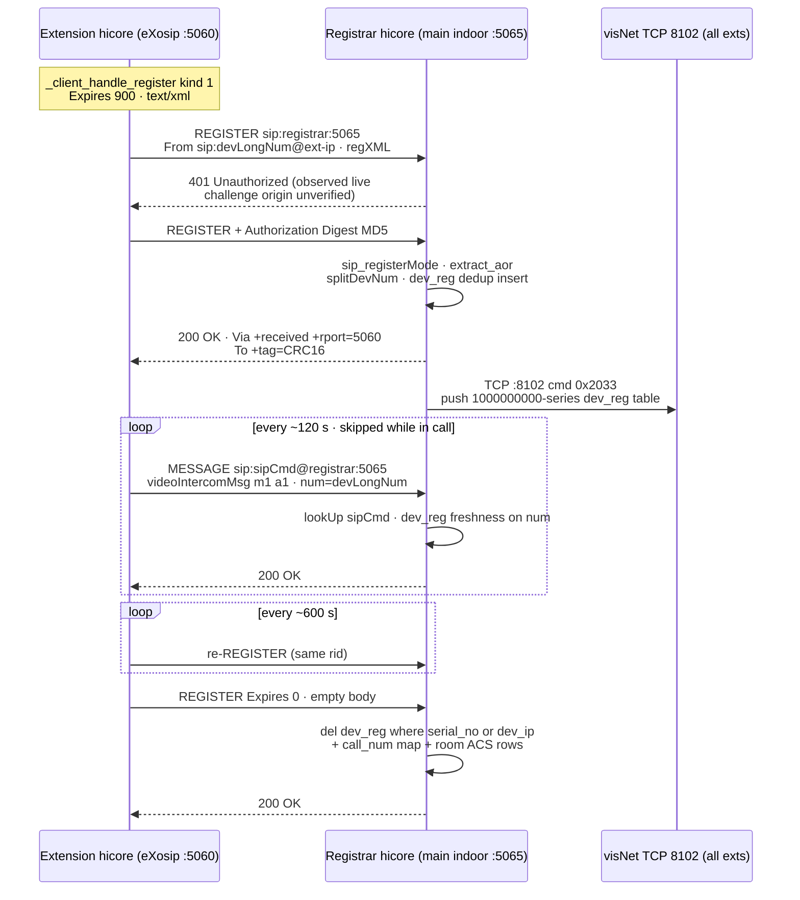

# Intercom registration & private-SIP communication — firmware internals

How `hicore` (Metzler VTH 2.0.24, rebranded Hikvision indoor station) registers
as an indoor-station/extension, keeps the binding alive, and resolves peers —
i.e. the device side of the "private SIP" layer. The wire-level description of
the same dialect is in [`../protocol.md`](../protocol.md); this doc is what the
firmware actually executes.

Sources: `readable/sip/{README.md,xml_proc.c}`, `readable/sip/client/*`,
`readable/sip/server/*`, `readable/visnet/visnet_server.c`,
`readable/misc/{net_sipClient_sip_client.c.c,net_sipServer_registrar.c.c,
dataManagement_database_db_api.c.c,util_common_visUtil.c.c,grouped.c}`,
plus `ANALYSIS.md` §3/4/5/8/9 (verified-live facts).

## 1. Two SIP stacks, three ports

| Role | Code | Port | Stack |
|---|---|---|---|
| SIP client (UAC+UAS) | `net/sipClient/sip_client.c` — `task_sipClient_UAS` @0x000e8318 | UDP **5060** | vendored eXosip2/osip2 (`misc/libeXosip2.so`, `eXosip_listen_addr(...,0x13c4,...)`) |
| Local registrar/forwarder | `net/sipServer/*` — `task_sipServer` @0x000db51c | UDP **5065** | own kamailio-style parser (`srv_parseMsg` @0x000cd3f4), stateless replies |
| visNet sync channel | `net/sipClient/visNetServer.c` | TCP **8102** | proprietary framed protocol, nonce+signature |

Client worker tasks spawned by `sip_taskUas` init (`readable/sip/client/ack_tail.c`):
`RegistCtrl` (0xe0dc4) or `voip_regist_task` (0xe1a04) depending on
`cfgTalkbackFlag`, `SipSessionCtrl` (0xe56e4), `HeartBeat` (0xe28dc, only when
`cfgTalkbackFlag()==0 && !netDualNic()`), `NewCall01/02`, `AlarmProc`,
`PasswdProc`, `ringBack`. `task_sipServer` runs on every device, but
`sip_udpProcRule` is only applied when `FUN_000f86b0()==1` (main-room box),
and `sip_insertCenterRecord` seeds the `ManageCenter` row only when
`FUN_000f86b0()!=0` (`readable/sip/server/sipServer.c`).

## 2. REGISTER — packet shape (`readable/sip/client/registration.c`)

`_client_handle_register` (`FUN_000e05e0`, a.k.a. `sipcli_register`) builds the
REGISTER per `kind`:

| `kind` | Purpose | R-URI / port | Expires | regXML fields |
|---|---|---|---|---|
| 1, 3 | normal register to our registrar | `sip:<registrar-ip>:5065` | **900** | kind 1 → `<sipNum>`+`<floorNum>` (indoor) / `<floorNum>` (other); kind 3 → serial+MAC only |
| 8 | name update | same | 900 | `+ <regDevName>` |
| 9 | "Pre-Regist" — inner device → door | `sip:<cfg proxy ip>:<cfg+0x35040 port>` | `cfg+0x350ce` **minutes** × 60 | serial+MAC only |

Header formats seen in the builder: `From = "sip:<devLongNum>@<localip>"`,
To/proxy among `sip:%s@%s`, `sip:1000000000%1d@%s`, `%s<sip:%s@%s>`,
`sip:%s@%s:%d`, `sip:username@%s:%d`; `Content-Type: text/xml`;
`User-Agent: eXosip/3.6.0`. Body always comes from
`_sip_xml_get_reg_info_xml` (`xml_getRegInfoXml` @0x000eb2e4,
`readable/sip/xml_proc.c`) — the `kind` is passed straight through as the
builder's mode selector:

```xml
<regXML>
  <regDevSerial>Q……</regDevSerial>      <!-- g_serial_no @0x00a11435, always -->
  <regDevMacAddr>xx:xx:xx:xx:xx:xx</regDevMacAddr>   <!-- always -->
  <sipNum>10000000001</sipNum>          <!-- kind==1 && indoor: own devLongNum (cfg+0x34fcc) -->
  <floorNum>3</floorNum>                <!-- kind==1: cfg+0x2d330/100 (type-2 sys) or u16@cfg+0x2d336 -->
  <regDevName>Room 2</regDevName>       <!-- kind==8: cfg+0x120 -->
</regXML>
```

(The `<version>` element from `ANALYSIS.md` §4 is *not* emitted by this build's
builder — unverified where it came from.)

Digest: `eXosip_add_authentication_info(user, authuser, passwd, "MD5", NULL)`
before send; a `401`/`407` is resent automatically by `eXosip_automatic_action`
(REGISTER_FAILURE path) or, for MESSAGEs, by `eXosip_default_action` after
re-adding auth info (`ack_tail.c` ev 12/31). Wire challenge observed:
`WWW-Authenticate: Digest realm="Hikvision", nonce, opaque` — **MD5 only**.
The `401` can be emitted by `send_reply`'s status table (below), but **no
digest verification or `WWW-Authenticate` generation exists anywhere in the
decompiled `net/sipServer` code** — the challenge origin is unverified
(the `"Hikvision"` rodata string exists at ~0x62e7a2; its SIP-side consumer
was not located — possibly in the undecompiled `srv_parseMsg`/`srv_forwardRequest`
path or the vendored eXosip).

## 3. Registrar pipeline — `sip_registerMode` @0x000d8dcc (`readable/sip/server/registrar.c`)

`sip_receiveMsg` (0x000db23c) → `sip_parseMsg` → `sip_udpProcRule` → REGISTER:

1. `parse_message` (0x000d7b40): To, Call-ID, CSeq required; Expires parses
   (`parse_expires` @0x000cd9f4, digit accumulator); every Contact hf parses.
   Failures set `g_reg_status` @0x00a6c080 (0xe..0x13).
2. `extract_aor` (0x000d77a4): To-URI user part, %-unescaped → `call_num`.
   `extract_host` (0x000d79e0) likewise demands an 11-char From user elsewhere.
3. Record fill — **0xb0-byte dev_reg row**: `+0x04 call_num[0x14]` (the AOR,
   must be exactly 11 chars else status 0x1a), `+0x18 dev_ip[0x10]` (source IP,
   *not* the Contact), `+0x28 reg_time[0x20]` (now+Expires as text),
   `+0x48 dev_type`, `+0x4c serial_no[0x30]`, `+0x7c mac_addr[0x14]`,
   `+0x90 dev_name[0x20]`. `dev_type`/`serial`/`mac`/`name` are **scraped by
   `strstr` from the raw body**, not XML-parsed — `<regDevSerial>`,
   `<regDevMacAddr>`, `<regDevName>` (caps 0x30/0x14/0x20).
4. `srv_splitDevNum` (`FUN_000f9418`, `misc/util_common_visUtil.c.c`) derives
   `dev_type` from `call_num` (table below). On a *subordinate* registrar
   (`FUN_0006498c()||FUN_00064c84()` — cfg u8@0x2d335==0 class flag) the
   registering number must share the local site prefix (type digit
   cfg+0x2d330, floor cfg+0x2d332, unit cfg+0x2d334), and type-3 ROOM
   registrations are refused on analog systems (`srv_isDigitalSys()==0` →
   `"VIS_DEV_TYPE_ROOM can't reg"`).
5. `Expires == 0` → **unregister**: `db_reginfo_del` with
   `where serial_no='<s>' or dev_ip='<src ip>'`, `FUN_000fdd54` drops the
   call_num map, ACS password rows `where room_num='<atoi(call_num+6)>'`
   deleted, `send_reply` → 200.
6. else `dpi_register_dev_reg_info` (below); on derived type 3 also
   `FUN_000fdca4(dev_name, call_num)` (room map) — then `send_reply` and
   `vns_registrarSyncHook` (§8).

Replies: `send_reply`/`sl_send_reply`/`build_res_buf_from_sip_req`
(0x000d8cd0/0x000d8ab4/0x000d7fa8) — stateless, `sendto` back to source IP
port **5060** (hard-coded `htons(5060)` — not the Via port). Status→code via
`g_reg_status`-indexed table @0x00a6c084: 400 `Bad Request`, 401 `Unauthorized`,
500, 503, 410 `Sip Gone`, else 200 `OK`. The builder injects
`;received=<src>` + `;rport=5060` into the top Via and a CRC16-CCITT
(`crcitt_string_array` @0x000d88a4, seed `b57ecd3250693a8f077639fd0317176b-`
over {callid, cseq, from-uri}) `;tag=` into To for codes <300.

### dev_reg dedup — `dpi_register_dev_reg_info` @0x000fc4a0 (`misc/dataManagement_database_db_api.c.c`)

Search `where call_num='<new>'`:

| Existing row | Action |
|---|---|
| none | delete `where serial_no='<s>' or dev_ip='<ip>'` (steal identity) → insert |
| serial **or** dev_ip matches new | delete `where serial_no or dev_ip or dev_name` → insert (**replace** — same device re-registering) |
| different serial **and** different ip, existing serial non-empty, **same dev_type** | return −1 → `send_reply` (**reject**, row kept) |
| different serial+ip, different dev_type | delete `where call_num` → insert (**replace**) |

`db_acspwd_gc` (same file) also sweeps `where reg_time<'<now>'` and deletes the
room's ACS pwd rows — expired registrations self-clean.

## 4. Numbering — `T FFF UU RRR II` (`readable/sip/server/registrar.c` header + `misc/util_common_visUtil.c.c`)

The 11-digit `devLongNum` is `sscanf("%01d%03d%02d%03d%02d")` →
`type digit, floor, unit, room, index`. `srv_splitDevNum` (registrar side) and
`devTypeFromNum` (`FUN_000f9ce0`, call side) classify:

| `call_num` shape | Class | Notes |
|---|---|---|
| `againdevice` | 6 | secondary door |
| `ManageCenter` | 2 | pseudo-device, seeded by `sip_insertCenterRecord` (reg_time `2037-12-31`) |
| `1000000000N` | 3 — ROOM | extension long-nums; `…0` = main indoor (`strncmp(num,"1000000000",10)`; tail `N` = extension index, 01–05 registered, idx>5 rejected by `sip_callLongNum`) |
| `unit!=0 && room!=0` | 3 — ROOM | canonical devLongNum; on non-type-2 systems re-split `%01d%03d%02d%01d%04d` |
| `unit!=0 && room==0` | 1 — DOOR (or 5 when cfg@0x6018==2, villa) | outdoor stations |
| `unit==0 && floor==0`: `room==2` → 4; `room==1` → 8 if idx 0, 7 if idx 1..50, 2 if idx<100 | wall/indoor specials |
| indoor `&&` not dual-NIC, non-`1000000000` name | 0xb | talkback class (`devTypeFromNum` only) |
| `10010199999` | — | `lookUp` alias: newest dev_type==3 row (FUN_00064c84-mode only) |

## 5. Timing — re-REGISTER and heartbeat

| Timer | Where | Value |
|---|---|---|
| `Expires:` sent | `_client_handle_register` | **900 s** (kinds 1/3/8); `cfg+0x350ce`×60 for door reg (kind 9). (`ANALYSIS.md` §4 shows a live REGISTER with `Expires: 600` — path/config-dependent or from a different build, not silently reconciled) |
| Re-register | `task_sipClient_RegistCtrl`/`voip_regist_task` loop | when `abs(now − last) > 600` s → `_client_handle_register(1)` / `_client_handle_reregister` (`eXosip_register_build_register` on the rid); earlier on net-change mq (`PROC_NETCHG_REG`) or `REGISTER_FAILURE` events |
| Heartbeat | `task_sipClient_HeartBeat` (`sipcli_hb_task` @0x000e28dc) | every **>0x77 s ≈ 120 s**, skipped while a call worker is busy (`talk_chan_state_get(0/1)` — "talking now!"), while net is down, or while own devLongNum isn't 11 chars |
| Registrar freshness | `lookUp`/`db_acspwd_gc` | `reg_time` stored as expiry timestamp text; stale rows treated as unregistered |

## 6. Heartbeat MESSAGE and the `sipCmd` virtual AOR

`task_sipClient_HeartBeat` → `sipcli_send_msg`/`_client_handle_send_sip_cmd`
(@0x000dc9b0): `MESSAGE sip:sipCmd@<registrar-ip>:5065`,
`Content-Type: text/xml`, body from `_sip_xml_get_sip_info_xml`
(@0x000ea910). Verified fields from the task: **method=1, action=1**,
`<from><deviceSN/><ipAddr>` = own ip, `<to><ipAddr>` = registrar ip block
(cfg+0x5fd0), body `<num>` = **own 11-digit devLongNum** (cfg+0x2d354):

```xml
<videoIntercomMsg><header><method>1</method><action>1</action>
<from><deviceSN>…</deviceSN><ipAddr>10.0.0.x</ipAddr></from>
<to><ipAddr>10.0.0.38</ipAddr></to></header>
<body><num>10000000001</num></body></videoIntercomMsg>
```

Registrar side (`lookUp` @0x000d9658, `readable/sip/server/reply.c`): AOR
`"sipCmd"` is a virtual name — it `strstr`s the body for
`<method>1</method><action>1</action>`, scrapes `<num>` (truncating at 11
chars — the closing tag is cut by `num_buf[0xb]=0`), searches
`where call_num='<num>'`, and returns 1 only while that registration is
unexpired; `srv_forwardRequest` then answers **200 OK directly** (no forward).
So the heartbeat doubles as a registration-freshness probe. (`<num>1</num>` as
sent by the sim truncates to a garbage call_num → this path predicts −1/404;
the 200 OKs seen live may come from the fallback `msg+0xd0`=own-IP forward to
the box's own :5060 UAS — unverified.)

## 7. OPTIONS keepalive

| Direction | Code | Behavior |
|---|---|---|
| inbound OPTIONS → :5060 | `_client_handle_message` @0x000ddbc8 (`uas.c`) | bare `200 OK`, no body |
| outbound OPTIONS | `event/alarmCtrl/talkBackNicBroken_c.c` (`misc/grouped.c` ~0x24c78) | `eXosip_options_build_request`/`send_request` ping of the talk peer every loop; `call_peer_alive_get` @0x000de598 reads `g_sip_peer_alive` @0x0081c550; >15 s dead → event 0xd + hang |
| OPTIONS response handling | `sip_taskUas` ev 29/31 (`ack_tail.c`) | 200 → `sip_hbReplyFlagSet` (peer-alive); failure → flag cleared |

`talkBackNicBroken` is a talkback watchdog — whether the registrar polls each
registered extension with OPTIONS the same way is **unverified** (the
extension→registrar liveness we know of is the heartbeat MESSAGE + reg_time).

## 8. Post-register visNet sync — TCP :8102

`vns_registrarSyncHook` (`FUN_000f1490`, `misc/net_sipClient_visNetServer.c.c`,
called at the end of `sip_registerMode` on success): enumerates the dev_reg
table and, for each `1000000000`-prefixed record, TCP-connects to that
device's **:8102** and pushes `cmd 0x2033` — a 0x420 packet carrying up to six
0xb0 dev_reg rows. The receiver (`readable/visnet/visnet_server.c`) stores them
into `g_extRoom` and re-registers each locally. Net effect: after every
successful REGISTER, the registrar **mesh-syncs the extension table to all
extensions** — this is the `:8102` connection observed right after REGISTER
(not merely a liveness probe; the table push is verified, a separate liveness
role is not).

## 9. MESSAGE/INFO vocabulary (`readable/sip/xml_proc.c`, `client/call_out.c`)

| Carrier | Body | Purpose |
|---|---|---|
| MESSAGE | `<videoIntercomMsg>` method 1 action 1 | heartbeat (above) |
| MESSAGE | method 2 a1 `roomNum/unlockPasswd/hijackPasswd`; method 3 a1 `delFlag/delLongNum/floorNum[/sipNum]` (the "Pre-Regist" push to doors, `sipcli_send_msg(...,"Pre-Regist",1)`); method 3 a3 `unlockPwd`; method 4 `roomNum`/`floor`; method 5 `responseStatus[/roomNum/subDoorInfo*8]`; method 6 `ID/devType/alarmTime/zone*`; method 7 `ipAddr/mode/channel/encrypt/type/deviceSN` | door↔room config exchange — parser `_sip_xml_pares` @0x000eb5ec requires every listed tag |
| MESSAGE | `<locknumXML><lockNum>n</lockNum></locknumXML>` | in-call door-lock select; UAS fast-path in `_client_handle_message`, clamped to lock range; sender `send_locknum_msg` @0x000dfa6c |
| MESSAGE | `<ringXML><noRingBack>1</noRingBack></ringXML>` | attached to `180 Ringing` when auto-answer (`call_autoanswer_gate`), builder @0x000eb508 |
| INFO | `Signal=<d>\r\nDuration=160` (`application/dtmf-relay`) | in-call DTMF / unlock; `sip_send_dtmf` @0x000df6c0 |

## 10. Busy flag, extension routing (`readable/sip/server/sipServer.c`, `client/uas_calls.c`)

Global busy flag `g_callBusy` @0x00819828 (`srv_getCallBusy` 0xda608 /
`srv_setCallBusy` 0xda63c) — **only writer is `sip_udpProcRule`** (0x000dabb8):
set when an INVITE to `ManageCenter`/`1000000000N` passes :5065; cleared by
BYE/CANCEL or a transit 408/603/486 reply; no timeout. `FUN_000e2bb0()==0`
("main indoor busy") gates identically.

| Reader | Busy effect |
|---|---|
| `sip_udpProcRule` | 2nd INVITE: `400 Bad request`+clear if same caller IP, else `486 Busy here` |
| `uas_handleInvite` @0x000e6e20 | incoming INVITE → `486 Busy Here` + missed-call CDR (also 486 when UI not ready; `480` in DND window; `488` when no/!parseable SDP; `400` on session-alloc failure) |
| `_client_call`/`sip_callLongNum`/`sip_client_call_manage_center` | early return — no packet sent (`callBusyChk`/`sess_idle_chk`) |

Extension call routing (`sip_callLongNum` @0x000e4ee0): `netAltRoute` →
`devLookup(num)` → **direct `sip:<num>@<dev-ip>:5060`** — registrar bypassed;
`netDualNic` → via mainroom `:5065` (called idx 0 → direct :5060). Only
`devTypeFromNum==3` numbers. `Subject: "This is a call to extension."`,
`From: sip:1000000000<own idx>@<localip>`. The `1000000000` contact-patch in
`sip_udpProcRule` rewrites the ext num to the main box's devLongNum on
ManageCenter calls (raw text, in place).

## 11. Sequence — register, heartbeat, unregister

<!-- mermaid: fw-registration -->


## 12. Key functions

| Function | Address | File | Role |
|---|---|---|---|
| `_client_handle_register` / `sipcli_register` | 0x000e05e0 | `sip/client/registration.c` | build+send REGISTER (kind 1/3/8→:5065 exp 900; 9→door) |
| `task_sipClient_RegistCtrl` | 0x000e0dc4 | `sip/client/registration.c` | registration controller, re-reg >600 s, net-change re-reg |
| `eXosip_client_voip_regist_task` | 0x000e1a04 | `sip/client/registration.c` | door→room registration task (2nd eXosip ctx) |
| `_client_handle_reregister` | 0x000e27fc | `sip/client/registration.c` | refresh REGISTER on existing rid |
| `check_regist_ip` | 0x000dbaa4 | `sip/client/registration.c` | registrar ip block validity (cfg+0x5fe8) |
| `collect_door_dev_info`/`fill_door_reg_info` | 0x000e2fb0/0x000e2d1c | `sip/client/registration.c` | door enumeration for pre-registration |
| `get_reg_dev_list` | 0x000e03b0 | `sip/client/registration.c` | dev_reg rows → caller array (skips ManageCenter) |
| `task_sipClient_HeartBeat` / `sipcli_hb_task` | 0x000e28dc | `sip/client/heartbeat.c` | ~120 s MESSAGE `sipCmd` heartbeat |
| `_client_handle_send_sip_cmd` / `sipcli_send_msg` | 0x000dc9b0 | `sip/client/heartbeat.c` | MESSAGE sender (`text/xml`, body builder arg) |
| `task_sipClient_UAS` / `sip_taskUas` | 0x000e8318 | `sip/client/uas.c`, `ack_tail.c` | eXosip :5060 listener + event dispatch |
| `_client_handle_message` | 0x000ddbc8 | `sip/client/uas.c` | OPTIONS→200; MESSAGE→locknumXML fast path / `_sip_xml_pares` dispatch |
| `uas_handleInvite` / `_client_handle_voip_request` | 0x000e6e20 | `sip/client/uas_calls.c` | incoming INVITE; 486/480/488/400 gates, 180, NewCall spawn |
| `call_handleBye` | 0x000e7d4c | `sip/client/ack_tail.c` | BYE→200 + teardown + cloud hang post |
| `sip_callLongNum` | 0x000e4ee0 | `sip/client/uas_calls.c` | extension call: dev_reg→direct :5060 INVITE |
| `sip_send_dtmf` / `send_locknum_msg` | 0x000df6c0/0x000dfa6c | `sip/client/call_out.c` | INFO dtmf-relay / MESSAGE locknumXML |
| `_sip_xml_get_reg_info_xml` / `xml_getRegInfoXml` | 0x000eb2e4 | `sip/xml_proc.c` | regXML builder (kind=mode selects fields) |
| `_sip_xml_get_sip_info_xml` / `xml_getSipInfoXml` | 0x000ea910 | `sip/xml_proc.c` | videoIntercomMsg builder, methods 1–7 |
| `_sip_xml_pares` / `xml_parseVideoMsg` | 0x000eb5ec | `sip/xml_proc.c` | videoIntercomMsg parser (0x138 out block) |
| `_sip_xml_get_lockNum_xml` / `_sip_xml_get_ring_xml` | 0x000ea82c/0x000eb508 | `sip/xml_proc.c` | locknumXML / ringXML builders |
| `sip_udpServerInit` / `task_sipServer` | 0x000da6f0/0x000db51c | `sip/server/sipServer.c` | bind UDP 5065, registrar task loop |
| `sip_receiveMsg` | 0x000db23c | `sip/server/sipServer.c` | datagram → parse → udpProcRule → REGISTER/forward dispatch |
| `sip_udpProcRule` | 0x000dabb8 | `sip/server/sipServer.c` | global busy flag owner, MC/ext gating, `1000000000` contact patch |
| `sip_insertCenterRecord` | 0x000da888 | `sip/server/sipServer.c` | seed `ManageCenter` dev_reg row (never expires) |
| `srv_getCallBusy` / `srv_setCallBusy` | 0x000da608/0x000da63c | `sip/server/sipServer.c` | `g_callBusy` @0x00819828 get/set |
| `sip_registerMode` / `regs_registerMode` | 0x000d8dcc | `sip/server/registrar.c` | REGISTER transaction end-to-end |
| `parse_message` | 0x000d7b40 | `sip/server/registrar.c` | required-header sanity (To/Call-ID/CSeq/Expires/Contact) |
| `extract_aor` / `extract_host` | 0x000d77a4/0x000d79e0 | `sip/server/registrar.c` | AOR scrape; From user must be 11 chars |
| `send_reply` / `sl_send_reply` | 0x000d8cd0/0x000d8ab4 | `sip/server/registrar.c` | status→code table; stateless reply to src:5060 |
| `build_res_buf_from_sip_req` | 0x000d7fa8 | `sip/server/registrar.c` | response builder (received=/rport=5060/CRC16 to-tag) |
| `lookUp` / `srv_lookUp` | 0x000d9658 | `sip/server/reply.c` | R-URI → dev_ip (ManageCenter/sipCmd/own/dev_reg) |
| `build_req_buf_from_sip_req` | 0x000d9eec | `sip/server/reply.c` | forward request: +`Via …:5065`, Contact→:5065 rewrite |
| `sip_forwardReply` | 0x000cb700 | `sip/server/forward.c` | stateless response forward + main-room Contact rewrite |
| `dpi_register_dev_reg_info` | 0x000fc4a0 | `misc/dataManagement_database_db_api.c.c` | dev_reg dedup insert (serial\|ip replace; num+type reject) |
| `db_acspwd_gc` | 0x000fc650 | `misc/dataManagement_database_db_api.c.c` | expired-reg sweep + room ACS pwd cleanup |
| `srv_splitDevNum` | 0x000f9418 | `misc/util_common_visUtil.c.c` | 11-digit → {type,floor,unit,room,idx} (registrar) |
| `devTypeFromNum` | 0x000f9ce0 | `misc/util_common_visUtil.c.c` | number → class byte (call path) |
| `call_peer_alive_get` | 0x000de598 | `sip/client/session_sdp.c` | OPTIONS liveness flag @0x0081c550 |
| OPTIONS watchdog (`talkBackNicBroken`) | ~0x24c00 | `misc/grouped.c` | `eXosip_options_*` peer ping, >15 s dead → hang |
| `vns_registrarSyncHook` | 0x000f1490 | `misc/net_sipClient_visNetServer.c.c` | post-REGISTER :8102 cmd 0x2033 table push |

## 13. Marked unverified

- **401 challenge origin** — wire shows `Digest realm="Hikvision"`, but no
  challenge/WWW-Authenticate generation exists in the decompiled `net/sipServer`;
  `send_reply` can emit bare `401 Unauthorized` via the status table.
- **Which g_reg_status maps to 401** — the status→code table @0x00a6c084 is
  data; values not recovered.
- **`<version>` regXML element** — seen in `ANALYSIS.md` §4 captures, not
  emitted by this build's `xml_getRegInfoXml`.
- **Registrar-side OPTIONS polling of extensions** — only the talkback-peer
  OPTIONS watchdog is in the decompile.
- **Heartbeat `<num>` mismatch** — code expects the sender's devLongNum for the
  dev_reg freshness check; the sim sends `<num>1</num>` and still reports 200
  OKs — acceptance looser than `lookUp` predicts.
- Per-door `kind==9` Pre-Regist addressing block (cfg+0x34fac/0x34fcc/0x34fec/
  0x35040/0x350ce) — fields inferred from offset comments, not verified live.
- `heartbeat.c` readable rewrite carries a stray "method 8" comment — the raw
  decompile of `sipcli_hb_task` sets method=1/action=1 directly; treat the
  comment as stale.
