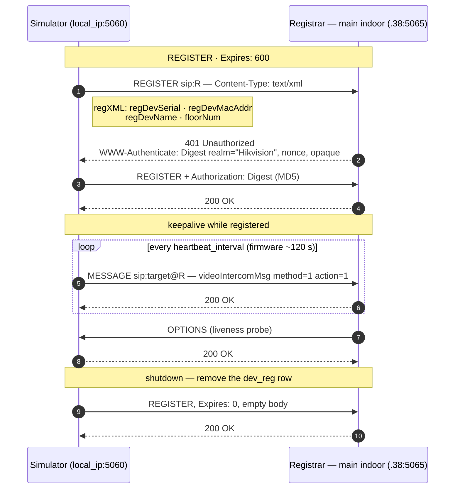
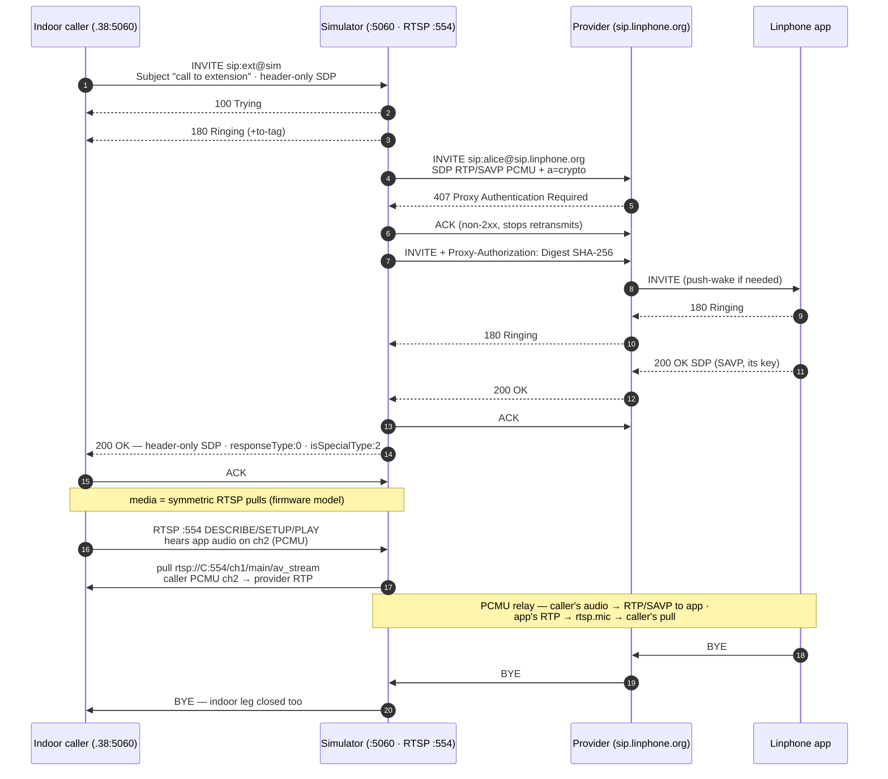
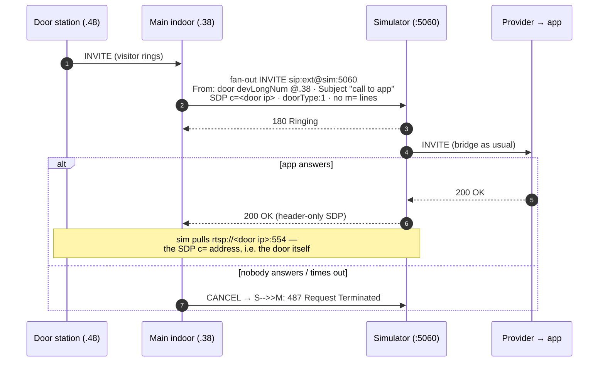
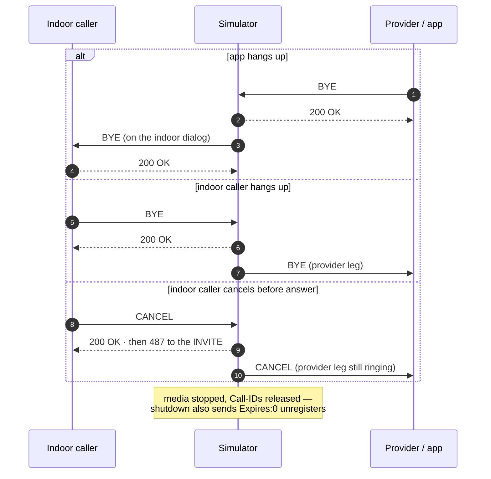
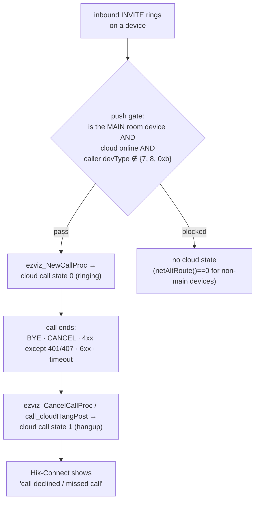

# The Hikvision private SIP dialect — and the standard-SIP leg

Two SIP worlds meet inside the simulator:

| | **Private intercom SIP** (firmware dialect) | **Standard SIP** (provider leg) |
|---|---|---|
| Peer | main indoor registrar `10.0.0.38:5065`, stations on `:5060` | `sip.linphone.org:5060` or a PBX |
| Registrar port | **UDP 5065** | UDP 5060 |
| Digest | MD5, `realm="Hikvision"` | SHA-256, `qop=auth`, `Proxy-Authorization` on 407 |
| Bodies | `text/xml` (`regXML`, `videoIntercomMsg`, …) | plain `application/sdp` |
| SDP | header-only (no `m=`) for intercom calls; private `a=` attributes | normal `m=`/`rtpmap` SDP |
| Media | **RTSP pulls** of `rtsp://<ip>:554/ch1/main/av_stream` | RTP/AVP or RTP/SAVP |

The firmware offers two selectable SIP modes, `Private` and `StandardSIP` —
this document covers `Private`, which is what the door/intercom system uses.

## The concrete differences vs standard SIP (RFC 3261)

The transaction skeleton is ordinary SIP — eXosip drives REGISTER → 401 →
digest retry → 200, INVITE → 100/180/200 → ACK, BYE/CANCEL/487 — so a packet
capture looks familiar until you open the bodies. Everything below is where
the dialect departs:

| # | Aspect | Standard SIP | Private intercom SIP |
|---|---|---|---|
| 1 | Registrar port | `5060` | **`5065`**; `:5060` is the station's own UAS |
| 2 | REGISTER body | empty (identity = AOR + Contact) | `text/xml` **`<regXML>`**: serial, MAC, name, floor — device identity, not just an address |
| 3 | Registration identity | keyed by address-of-record | dedup on **serial *or* IP** — a second device with either steals the row; same number + different serial+IP is *rejected*; unregister needs `Expires: 0` with an **empty** body |
| 4 | Registrar role | proxy/registrar in the call path | a **directory**: room calls are resolved via `dev_reg` then INVITEd **directly** to `dev_ip:5060` — the registrar never sees the call |
| 5 | INVITE media offer | `m=` lines negotiate codecs + RTP ports | **header-only SDP** (`v/o/s/c/t` + private attrs, **zero `m=` lines**) for intercom calls — SIP negotiates *no* media at all |
| 6 | Media transport | RTP endpoints negotiated in SDP | **symmetric RTSP pulls**: each side pulls `rtsp://<peer>:554/ch1/main/av_stream` (Basic `admin:<ext-pw>`, interleaved RTP-over-TCP, PCMU on ch 2) |
| 7 | Extra SDP attributes | `a=rtpmap`, `a=sendrecv`, codec params | five private attrs: `doorFloor`, `responseType`, `doorType`, `isSpecialType`, `isConfirm` — call metadata a normal UA never produces |
| 8 | Answer semantics | `200 OK` = accepted, period | the 200 OK's **`responseType`** field reports the outcome: `0` answered · `1` timeout · `3` rejected · `4` re-notify — a 200 that means "declined" |
| 9 | UI control | none (UI is local) | **`isSpecialType` steers the remote screen**: `2` → audio/talk UI, `0` → video-session UI — the callee decides how the caller renders the call |
| 10 | Call classification | URI + context; Subject is display text | `Subject:` is a **protocol field**: `"This is a call to extension."` vs `"This is a call to app."`, plus `doorType` echoing the caller's device class |
| 11 | Keepalive | re-REGISTER, OPTIONS ping, or CRLF | periodic `MESSAGE` with **`<videoIntercomMsg>`** XML (`method=1 action=1`) on top of re-REGISTER |
| 12 | In-dialog control | INFO/REFER/NOTIFY events | `MESSAGE` `<locknumXML>` lock select · `INFO` `application/dtmf-relay` for unlock DTMF · proprietary XML vocabulary throughout |
| 13 | Auth | MD5 (legacy) or SHA-256 | MD5 only, `realm="Hikvision"` — but challenges may carry `random=`/`qop=`/`algorithm=` params |
| 14 | Forking | proxy forks to all contacts | **main indoor fans out** door calls itself: direct INVITEs to each registered extension (max ~5), acting as the forking proxy |
| 15 | Busy semantics | per-UA or per-dialog | **one global busy flag** on the main indoor — an un-ended call makes the whole system `486` until a BYE/CANCEL/4xx/6xx clears it |
| 16 | Fixed-port talkback | always negotiated | call-type `0xb` uses **hard-coded RTP 9654 / RTCP 9655**, audio+video demuxed by payload type — no negotiation whatsoever |

Practical consequences for the sim:

- A normal SIP UAC against `:5065` can *register* (digest works), but a
  normal INVITE is useless — without `m=` lines the call has no media path,
  and without the private attrs the firmware UI misclassifies it.
- Conversely, offering the provider *only* header-only SDP would get no media
  either — the bridge exists precisely because the two media models don't
  overlap: **RTSP pull ↔ negotiated RTP**.
- `responseType` and `isSpecialType` must be echoed exactly, or the calling
  station shows the wrong screen; `doorType:0` on our answers keeps us
  classified as a room device, not a door.

## 1. Registration

<!-- mermaid: registration -->


- `regXML` fields: `version`, `regDevName`, `regDevSerial`, `regDevMacAddr`;
  `sipNum`/`floorNum` are accepted extras. Serial+IP is the device's identity —
  re-registering the same serial or the same `dev_ip` **replaces** the existing
  row; a different device with the same `call_num` and `dev_type` is rejected.
- Digest is plain RFC 2617 MD5 over `realm="Hikvision"`; the registrar also
  parses `random=`, `qop`, `algorithm=` challenge parameters.
- Heartbeat is a `MESSAGE` whose XML body is
  `<videoIntercomMsg><header><method>1</method><action>1</action>
  <from/><to/></header><body><num>1</num></body></videoIntercomMsg>`,
  in addition to re-REGISTERing before expiry.
- Unregister must send `Expires: 0` with an **empty** body — carrying `regXML`
  anyway can keep the row alive.
- Right after REGISTER the main indoor also connects to the client's TCP
  `:8102` (visNet probe — liveness, safe to leave closed for a pure SIP sim).

## 2. Numbering

| Number shape | Class | Meaning |
|---|---|---|
| `1000000000N` | 3 — room | indoor extensions; `…00` is the main indoor itself |
| `ManageCenter` | 2 | management center |
| `%01d%03d%02d%03d%02d` (devLongNum) | 1 — door | outdoor/door stations |
| other | 6 — againdevice | secondary door devices |

Call routing (`sip_callLongNum` in the firmware): room-type numbers are looked
up in `dev_reg` and sent **directly** to `sip:<num>@<dev-ip>:5060` — the
registrar is not in the signaling path. Door numbers go through the main
indoor. The sim's `--call` mirrors this: `num` → registrar `:5065`,
`num@ip` → direct `:5060`.

## 3. Incoming INVITE classification

Three things identify an intercom/extension call (as opposed to a door call):

| Signal | Extension call | Door call |
|---|---|---|
| `Subject:` | `This is a call to extension.` | `This is a call to app.` |
| `From:` | `sip:1000000000N@<ip>` (a room number) | door `devLongNum`, relayed by `.38:5060` |
| SDP body | **header-only**, no `m=` lines | `m=audio` + `m=video` present (direct door calls); header-only on the .38 fan-out leg |

The sim classifies by the offer: a real `m=audio` → `kind="door"` (RTP relay);
otherwise `kind="intercom"` (RTSP media).

### Private SDP attributes

The header-only template is `v/o/s/c/t` plus five `a=` metadata lines:

```sdp
v=0
o=<serial> 0 0 IN IP4 <ip>
s=Talk session
c=IN IP4 <ip>
t=0 0
a=doorFloor:0
a=responseType:0
a=doorType:0
a=isSpecialType:2
a=isConfirm:0
```

| Attribute | Meaning |
|---|---|
| `doorFloor` | door station floor index |
| `responseType` | answer outcome: `0` answered, `1` timeout/408, `3` rejected, `4` in-call re-notify |
| `doorType` | **caller's own** device class (1 = door) — not the callee's |
| `isSpecialType` | in-call UI selector: `2` → audio/talk UI (no remote-video rect); `0` → video UI. All indoor stations send `2` |
| `isConfirm` | call-confirm flag |

`isSpecialType` is the single byte that decides whether the caller renders a
video-style session or the plain talk screen — the sim must echo `2`.

## 4. Intercom/extension call — bridged to the provider

<!-- mermaid: intercom-call -->


Media details:

- Both stations run an RTSP server on **TCP 554**,
  `rtsp://<ip>/ch1/main/av_stream`, HTTP-Basic `admin:<extension password>`.
  DESCRIBE advertises `m=video … trackID=1` (H264 `profile-level-id=4D0014`)
  and `m=audio … trackID=2` (PCMU/8000); interleaved RTP-over-TCP, video on
  channel 0/1, audio on 2/3.
- Real indoor↔indoor calls carry **audio only**: the `:554` stream emits PCMU
  on ch2 and never sends video, even though DESCRIBE advertises it.
- The sim's `RtspServer` mirrors that: DESCRIBE advertises both tracks
  (`INDOOR_RTSP_VIDEO=1` also streams a test H264 pattern), PLAY streams paced
  160 B PCMU frames (20 ms) from `rtsp.mic`.
- `SipIntercomMedia` glue: pulled caller PCMU → PT0 RTP to the provider peer;
  provider RTP (PT0, optionally SRTP-decrypted) → `rxq` → `mic_frame()` → the
  caller's pull. ~1 s jitter bound on the queue.

## 5. Door calls

<!-- mermaid: door-call -->


- The fan-out comes from the **main indoor's own stack** `.38:5060`, not the
  registrar — extensions are dialed directly at `dev_ip:5060` (max ~5 slots).
- `c=` in the fan-out offer already points at the **door's** IP, so
  `SipIntercomMedia` pulls `rtsp://<door>:554` for the door's camera+audio.
- An extension that `200 OK`s the fan-out stops the main indoor's own ringing;
  the main indoor tears the leg down itself after ~45–60 s (door-call timeout).
  That's why the sim defaults to ring-only on door legs
  (`INDOOR_AUTO_ANSWER` / `auto_answer` policy).
- Variant with real `m=` lines (door station dialing us directly): the sim
  answers with `sdp_answer_firmware` (PCMU `m=audio`, H264 `m=video` on our
  RTP ports) and runs two `RtpRelay`s — door RTP ↔ provider RTP, SRTP
  wrapping the provider direction. Video is one-way H264 ES, PT 96.
- **Door-call recognition** mirrors the firmware (`FUN_000f9ce0`): the
  caller's number class (`10010100000`-style devLongNum → type 1) OR
  `Subject: "call to app."` OR `a=doorType:` > 0 marks the call outdoor.
  Only such calls get a video channel — extension calls stay audio-only.
- **Door video → provider**: the pulled H264 stream (door's `:554`, the
  `c=` address of the fan-out offer) is repacked as PT96 RTP — source
  timestamps kept, our seq/ssrc — and forwarded on a `m=video` leg of the
  provider call. With SRTP on, the video `m=` line gets its own `a=crypto`.
- **Early media**: any 18x provider response carrying SDP (typically
  `183 Session Progress`) latches the media address and starts streaming —
  the app can receive the door's video while the call still rings; the
  indoor leg keeps ringing until the provider's `200 OK`.
- DTMF/unlock in-dialog: `INFO` with `application/dtmf-relay`
  (`Signal=<d>` / `Duration=160`); lock selection uses `MESSAGE` with
  `<locknumXML><lockNum>n</lockNum></locknumXML>`.

## 6. Provider leg specifics

- REGISTER and INVITE authenticate separately: `401` → `Authorization`,
  **`407` → `Proxy-Authorization`** — always digest **SHA-256** for linphone
  (`qop=auth`, cnonce/nc counted, `opaque` echoed). Its challenges send
  `algorithm=SHA-256` **unquoted** — the parser must accept that form.
- Every non-2xx response to an outbound INVITE gets an **ACK on the same
  branch** — otherwise the proxy retransmits forever.
- All `1xx` responses are progress: `100 Trying`, `110 Push sent`, `180`,
  `183` — none of them may fail the call. A `1xx` **with SDP** additionally
  enables early media (streaming starts immediately).
- NAT: after a provider `200 OK`/`401` the Via's `received=`/`rport=` give our
  public endpoint; it is advertised in provider-leg SDP `c=`/Contact so media
  can return.
- Fork loop prevention: flexisip rings **every** registered contact of the
  account — including the sim itself. Its own fork is matched by Call-ID and
  silently ignored (not declined — a `486` would kill the call while pushed
  phones are still waking). Call-IDs stay remembered after the call so late
  retransmits can't reopen it. Inbound calls arriving *from* the provider
  address are declined — bridging them back would loop the account.
- `488 Not acceptable here` → one retry with `RTP/AVP` (plain RTP). With SRTP
  enabled (default) the offer is `RTP/SAVP` + `a=crypto:` per stream.

## 7. Teardown — and the Hik-Connect side effects

<!-- mermaid: teardown -->


<!-- mermaid: cloud-push -->


The "call declined" cards in Hik-Connect are generated by **the main indoor's
firmware**, not by the sim:

- `ezviz_NewCallProc` pushes cloud state `0` when a call starts ringing —
  only on the main-room device, only while the cloud channel is online, and
  never for caller types `{7, 8, 0xb}` (indoor/door classes that don't
  produce app cards).
- `ezviz_CancelCallProc`/`call_cloudHangPost` push state `1` on any ending —
  BYE, CANCEL, reject (`4xx` other than auth), or timeout. The app renders a
  state-1-after-state-0 call as "declined/missed".
- Consequence for the sim: once a bridged call reaches `200 OK` and ends by
  BYE, the card is a normal hangup. The "declined" impression came from our
  earlier 4xx rejections while the provider leg was failing. A call that is
  properly classified as room/intercom and answered normally produces the
  least noisy cloud trace; the push itself can't be disabled from the
  callee side — it's the main indoor's own behavior.

## 8. Safety notes

- The main indoor keeps **one global busy flag**: an INVITE routed through
  `:5065` that is never ended (no BYE/CANCEL, no 4xx/6xx) wedges the whole
  system — every later call gets `486`. Always end legs; the sim does it on
  shutdown (`bye_intercom`/`provider.bye` + `Expires: 0` unregisters).
- `dev_reg` deduplicates on **serial or IP**: a second sim must use a
  distinct serial **and** a distinct `local_ip`, and never take another
  station's `call_num`.
- `OPTIONS` probes must get `200 OK` — the registrar liveness check depends
  on it.
